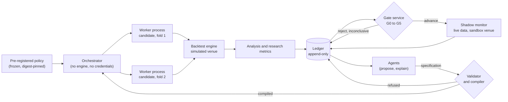

# Autonomous strategy discovery: design considerations

This document designs a research capability: a discovery layer that generates candidate trading
strategies, evaluates them through this repository's own deterministic machinery, challenges their
assumptions, and holds credible ones for human review. It is a design document. It states the
problem, the candidate designs, the boundaries, and the tradeoffs, and it is not a commitment to
implement anything.

Three proposal documents were supplied and are the input to this design: `purposal/research1.md`
(an agent architecture for an autonomous research lab), `purposal/research2.md` (the same, narrowed
to swing trading in US equities and ETFs, hybrid LLM and evolutionary search, with NautilusTrader as
the backtest foundation and execution disabled), and `purposal/research3.md`, the revised proposal.
The third reorders the plan around three changes: reuse the research and statistical infrastructure
this repository already has, make the strategy compiler the central new component, and treat
execution timing as a correctness invariant rather than a backtest configuration option.

The third document is read as the revision of the first two, not as a third opinion. Where it
differs from them it is the input, and where it differs from this design the disagreement is
recorded rather than silently resolved. Section 3.1 maps each of its revised decisions onto the
section that dispositions it, and names the requirements it adds and the one point it raises that
this document does not settle.

The companion implementation plan is not written. Section 16 carries the milestones it would
expand, and Section 18 records what remains open.

Revision note: second revision. The first revision read the two original proposal documents,
inventoried what this repository already provides against what they ask for, sourced the validation
statistics from the primary literature rather than from the proposals' summaries, and decided the
placement, boundaries, language, ledger, gates, and search. This revision reads the third document
as the revised proposal and adopts its execution-timing contract (Section 8.5), its compiler
responsibilities (Section 9.3), its lineage and trial-identity rules (Sections 8.4 and 10.5), its
conditional admission gate (Section 7.4), and its milestone order (Section 16). Fifteen decisions
are recorded in Section 17; five questions are left open in Section 18.

## 1. Purpose and scope

The proposals ask for a system that finds strategies rather than executes them. The distinction
they draw is the correct one and this design keeps it: language models propose, deterministic code
tests, and an independent validation layer decides whether the evidence is credible. A strategy
must never pass validation because an argument for it was persuasive.

Goals:

- Generate candidate strategies from economic hypotheses, not from curve fitting to a past return
  series.
- Evaluate every candidate through this repository's authoritative simulation, with the cost,
  timing, corporate-action, and universe semantics the engine actually has rather than the semantics
  a proposal assumes it has.
- Account for the entire search, including failed and abandoned candidates, when a result is
  reported as significant.
- Keep the gates, thresholds, risk constraints, and holdout outside the reach of the search that
  they judge.
- Produce, for every candidate that advances, an evidence package that a third party can recompute
  from stored inputs alone.
- Stop at a shadow stage. No order submission, no broker credential, no live authority.

Non-goals:

- Profitability. No architecture can guarantee an edge, and a discovery layer that could would not
  need one. The deliverable is evidence, not a return.
- Live or semi-live trading. The discovery layer has no order-submission capability and does not
  acquire one by configuration.
- A second engine, a second statistics implementation, or a second store of truth. Where this
  repository already holds a primitive, the discovery layer composes it.
- Language-model authority over any number that enters a gate.
- Language-model-authored code that executes. Candidate strategies are data in a constrained
  language, compiled by deterministic code (Section 9).
- Upstream contribution. `ROADMAP.md` places "integrated hyper-parameter optimization or built-in
  AI/ML tooling" outside the project's scope, with users expected to integrate their own frameworks.
  This design is therefore fork research tooling that consumes the platform's public surfaces, and
  it adds nothing to the kernel.

### The central contract

> The discovery layer may propose anything and may decide nothing. Every candidate is represented
> as data in a fixed language, every number in its evidence package is recomputed by deterministic
> code from stored inputs, and every threshold it is judged against was fixed and versioned before
> the run that produced it. The search may never widen a gate, read the holdout, or hold execution
> authority.

Five consequences, each of which a later section makes concrete:

1. The candidate language is closed and validated. A proposal that does not compile is a recorded
   refusal, not an experiment (Section 9).
2. Evidence is produced by the existing analysis, research, optimization, and event-store surfaces,
   not by a new parallel implementation (Sections 6 and 7).
3. Gates are conjunctions of pre-registered conditions. A high return cannot compensate for a
   failed look-ahead or cost check (Sections 11 and 17).
4. The trial inventory is part of the evidence. A significance claim names the search that produced
   it, including the candidates that failed (Sections 7 and 10).
5. Execution authority is absent by construction, and its absence is tested rather than asserted
   (Section 12).

## 2. Method and evidence

Three bodies of evidence were used, in this precedence order: this repository's code, tests, and
stored artifacts; the primary sources of the statistics the gates rely on; and the three proposal
documents, which are treated as requirements and not as facts. The third is the revision of the
first two, and where it supersedes them, it is the requirement this document dispositions.

The repository was read directly. A capability is called present only where a symbol, test, or
stored artifact was found; absence claims come from searches that returned nothing, and are
reported as searches rather than as proofs. Proposal claims about the engine were checked against
the engine, and where they disagree the repository wins; Section 6.3 lists the disagreements
found.

The statistics were checked against their own papers. Where a formula could not be transcribed
exactly from the source's text layer, the reconstruction is named as such and cross-checked against
the authors' own code or a second implementation. Section 7.6 lists everything that could not be
verified, including two paywalled published versions whose author preprints were read instead.

The prior art was checked for what it measured. Claims about language-model strategy discovery in
the proposals are cited to papers that exist, and the papers' own evaluation protocols are reported
next to their headlines (Section 10.7).

### 2.1 Primary sources read, and what each established

| Source                                                                                                                                                                                                                                                                                                                                                          | What it established                                                                                                                                                                                                                                                                                                                           |
| --------------------------------------------------------------------------------------------------------------------------------------------------------------------------------------------------------------------------------------------------------------------------------------------------------------------------------------------------------------- | --------------------------------------------------------------------------------------------------------------------------------------------------------------------------------------------------------------------------------------------------------------------------------------------------------------------------------------------- |
| Bailey and Lopez de Prado, *The Deflated Sharpe Ratio: Correcting for Selection Bias, Backtest Overfitting, and Non-Normality*, Journal of Portfolio Management 40(5) 94-107, 2014, DOI [10.3905/jpm.2014.40.5.094](https://doi.org/10.3905/jpm.2014.40.5.094). [Author preprint](https://davidhbailey.com/dhbpapers/deflated-sharpe.pdf) of 31 July 2014 read. | The DSR is a probabilistic Sharpe ratio whose rejection threshold is the expected maximum of the trial Sharpe ratios; it needs the trial count, the cross-trial dispersion, the sample length, and the selected strategy's skew and non-excess kurtosis; correlated trials require an effective trial count (Appendix A.3).                   |
| Bailey, Borwein, Lopez de Prado, Zhu, *The Probability of Backtest Overfitting*, working paper revision of 27 February 2015, journal version DOI [10.21314/jcf.2016.322](https://doi.org/10.21314/jcf.2016.322). Author [working paper](https://www.davidhbailey.com/dhbpapers/backtest-prob.pdf) of 27 February 2015 read.                                     | The CSCV procedure: a synchronous trial-by-time performance matrix, S contiguous row blocks, all S/2-sized combinations, in-sample and out-of-sample ranks, the logit transform, and the probability that the in-sample best lands below the out-of-sample median. S = 16 gives 12,780 combinations.                                          |
| Lopez de Prado, *The 10 Reasons Most Machine Learning Funds Fail*, 2018, and *Advances in Financial Machine Learning*, Wiley 2018, chapter 7 (chapter structure read from the author-posted front matter).                                                                                                                                                      | The exact purging and embargo definitions: purge training observations whose label interval overlaps the evaluation set's, and embargo the observations immediately following a test set, with h of about one percent of the sample.                                                                                                          |
| White, *A Reality Check for Data Snooping*, Econometrica 68(5) 1097-1126, 2000, DOI [10.1111/1468-0262.00152](https://doi.org/10.1111/1468-0262.00152). [Full paper](https://users.ssc.wisc.edu/~behansen/718/White2000.pdf) read.                                                                                                                              | The reality check tests whether the best model in a specification search beats a benchmark, using the stationary bootstrap of Politis and Romano (1994); the statistic is non-pivotal and admits no higher-order refinement.                                                                                                                  |
| Hansen, *A Test for Superior Predictive Ability*, Journal of Business and Economic Statistics 23(4) 365-380, 2005, DOI [10.1198/073500105000000063](https://doi.org/10.1198/073500105000000063).                                                                                                                                                                | The studentized SPA statistic with a sample-dependent null, and the demonstration that the reality check's power can be driven to zero by adding poor alternatives. Its stated limit is that recursively estimated parameters are not accommodated.                                                                                           |
| Politis and White, *Automatic Block-Length Selection for the Dependent Bootstrap*, Econometric Reviews 23(1) 53-70, 2004, DOI [10.1081/ETC-120028836](https://doi.org/10.1081/ETC-120028836). [Full paper](https://public.econ.duke.edu/~ap172/Politis_White_2004.pdf) read.                                                                                    | The automatic block-length rule, its flat-top lag window, the m = 2m-hat recipe, the relative inefficiency of the stationary bootstrap (ARE between 0.331 and 0.481), and its downward bias under strong persistence.                                                                                                                         |
| Bailey, Borwein, Lopez de Prado, Zhu, *Pseudo-Mathematics and Financial Charlatanism*, 2014, published in Notices of the AMS 61(5) 458-471. [Author preprint](https://www.davidhbailey.com/dhbpapers/backtest-pseudo.pdf) of 1 April 2014 read.                                                                                                                 | The minimum backtest length relation, and its worked example: with five years of data, no more than 45 independent configurations should be tried.                                                                                                                                                                                            |
| Romera-Paredes et al., *Mathematical discoveries from program search with large language models*, Nature 625, 468-475, 2024, DOI [10.1038/s41586-023-06924-6](https://doi.org/10.1038/s41586-023-06924-6).                                                                                                                                                      | The evaluated-evolution loop: a frozen model proposes program mutations, an automatic evaluator scores them, an island population keeps diversity, and invalid programs are discarded.                                                                                                                                                        |
| Novikov et al., *AlphaEvolve: A Gemini-powered coding agent for designing advanced algorithms*, 2025, arXiv [2506.13131](https://arxiv.org/abs/2506.13131). White paper.                                                                                                                                                                                        | The same loop with staged evaluation cascades; the authors' own main limitation, that it works only where an automated evaluator exists; and that sandboxing is not offered as its safety mechanism.                                                                                                                                          |
| Sharma and Shroff, *AlgoEvolve: LLM-driven Meta-evolution of Algorithmic Trading Programs*, 2026, arXiv [2606.26173](https://arxiv.org/abs/2606.26173). Preprint.                                                                                                                                                                                               | Cited by `purposal/research1.md`; it exists. It reports an annualised Sharpe of 5.60 on anonymised intraday paper-trading data over more than 200 days, with no transaction costs, no commissions, no slippage and no multiple-testing control. It is evidence of feasibility, not of profitability, and the proposal hedges it the same way. |
| Xiao et al., *TradingAgents: Multi-Agents LLM Financial Trading Framework*, 2024, arXiv [2412.20138](https://arxiv.org/abs/2412.20138), presented as an ICML 2025 workshop poster.                                                                                                                                                                              | The architecture the proposals call "TradingAgents-style" exists and is reviewed only at workshop level.                                                                                                                                                                                                                                      |
| *Reproducibility in the TradingAgents Framework*, 2026, ACM DOI [10.1145/3800973.3801029](https://doi.org/10.1145/3800973.3801029).                                                                                                                                                                                                                             | An independent study over GOOGL, May to July 2025: without cherry-picking the temperature, seed and sampling parameters, the agent framework does not beat buy-and-hold.                                                                                                                                                                      |
| Ye et al., *The Alpha Illusion*, 2026, arXiv [2605.16895](https://arxiv.org/abs/2605.16895). Position paper.                                                                                                                                                                                                                                                    | Reported alpha from end-to-end language-model trading agents should not be treated as deployment evidence.                                                                                                                                                                                                                                    |
| Shi, Yan, Cai, Lv, *Hubble*, 2026, arXiv [2604.09601](https://arxiv.org/abs/2604.09601).                                                                                                                                                                                                                                                                        | A DSL with an AST execution sandbox for factor and strategy discovery; states that unconstrained program generation is operationally unsafe; held-out evaluation from June 2025 to March 2026.                                                                                                                                                |
| Huang et al., *From Hypotheses to Factors*, 2026, arXiv [2604.26747](https://arxiv.org/abs/2604.26747).                                                                                                                                                                                                                                                         | A point-in-time factor DSL, an append-only experiment trace, fixed splits, selection gates and costs inside a deterministic engine; the proposal's architecture, published, with a cost-adjusted out-of-sample result.                                                                                                                        |
| Glasserman and Lin, arXiv [2309.17322](https://arxiv.org/abs/2309.17322); Sarkar and Vafa, ICML 2025 workshop, OpenReview `fn9cJkB86T`; Gao, Jiang, Yan, arXiv [2512.23847](https://arxiv.org/abs/2512.23847); Li et al., *Profit Mirage*, arXiv [2510.07920](https://arxiv.org/abs/2510.07920).                                                                | Pretrained models leak information about periods inside their training window; prompting-based mitigations are limited; measured leakage statistics collapse after the training cutoff and backtested returns evaporate once the knowledge window ends.                                                                                       |
| `nautechsystems/nautilus_agents` (official, alpha) and `KuaaMU/sextant` (third party, immature).                                                                                                                                                                                                                                                                | The official agents project grants an agent one semantic action, position reduction, and no engine or venue authority. No mature NautilusTrader project performing automated strategy discovery was found.                                                                                                                                    |
| gVisor security model documentation; Kubernetes seccomp and Pod Security Standards documentation.                                                                                                                                                                                                                                                               | What a syscall-level sandbox does and does not give: gVisor's own text states that a sandbox is not a substitute for a secure architecture and gives no protection against hardware side channels; resource exhaustion is handled by the host's cgroups, not by the sandbox.                                                                  |
| OpenLineage object model; MLflow tracking documentation.                                                                                                                                                                                                                                                                                                        | There is no single published standard for an immutable research run manifest. OpenLineage is the nearest external model (run, job and dataset events keyed by a run id), and MLflow's records are writable through its API rather than append-only.                                                                                           |

### 2.2 What the proposals could not support

`purposal/research1.md` carries three citations that do not resolve as sources: a vendor image URL
rendered as a "ReportLab tutorial" link, and two favicon links to `doi.org` and `sciencedirect.com`
with no title, author, or year attached. Two claims rest on them, the attribution of the deflated
Sharpe ratio and a statement that temporal validation alone may not prevent false discoveries. Both
claims are true in substance and are sourced in Section 2.1 from the primary literature, but the
proposal's own citations cannot be followed. `purposal/research2.md` cites no external source by
URL, and neither does `purposal/research3.md`. The revised proposal's one quantitative claim, the
admission ceiling taken up in Section 7.4, is inherited from the literature this study read rather
than from a source of its own, and the revised proposal states that both the figure and its precise
integration points still need verification against the fork's contracts. Section 3.1 and Section 18
take that up.

## 3. The proposal, restated as requirements

The two documents are consistent in architecture; the second narrows the first. Their asks are
collected here as requirements, with the verdict each receives in Section 6.

| ID  | Requirement                                                                                                                  | Proposal source                                    | Verdict in this repository                                                                                    |
| --- | ---------------------------------------------------------------------------------------------------------------------------- | -------------------------------------------------- | ------------------------------------------------------------------------------------------------------------- |
| R1  | Point-in-time research data: prices, corporate actions, universe membership, fundamentals, benchmark and regime context      | `research2.md` sections 1, 3                       | Mostly present; fundamentals absent (Section 6.1)                                                             |
| R2  | Signal timing rules: decide after a close, become eligible in the next session, fundamentals at publication time             | `research2.md` section 3                           | Engine contradicts the naive use; the pieces exist, the wiring does not (Section 6.3)                         |
| R3  | A feature registry with named producers and availability timestamps, selected by candidates rather than invented by them     | `research2.md` section 3                           | Present as a panel, feature compiler, labels, membership series and operators (Section 6.1)                   |
| R4  | A constrained strategy language and a deterministic compiler; no unrestricted generated code                                 | `research2.md` section 4                           | Absent, and the one missing piece that everything else depends on (Section 9)                                 |
| R5  | Agent roles with separated authorities: hypothesis, translation, analysis, adversarial review, search strategy               | `research1.md` section 3, `research2.md` section 5 | Absent (Section 10)                                                                                           |
| R6  | Grammar-constrained evolutionary search with mutation, recombination, deduplication, diversity preservation and budgets      | `research2.md` section 6                           | Parameter-level search present; genome-level absent (Section 10.3)                                            |
| R7  | An immutable experiment ledger with candidate lineage, data snapshots, config and code hashes, seeds, statuses and artifacts | `research2.md` section 7                           | Two disjoint stores exist; the join and the trial inventory do not (Section 8.4)                              |
| R8  | A validation service with fixed, versioned, pre-registered gates that no agent can waive                                     | `research2.md` section 8                           | The statistics exist and are declared contracts; the service does not (Section 7)                             |
| R9  | Walk-forward and purged, embargoed evaluation with an untouched final holdout                                                | `research1.md` section 4, `research2.md` section 8 | Present, including purge, embargo and label-overlap enforcement (Section 6.1)                                 |
| R10 | Multiple-testing accounting over the whole search, with the trial count and its dependence declared                          | `research1.md` section 4, `research2.md` section 8 | Deflated Sharpe ratio and trial provenance present; the search-wide inventory is absent (Sections 7 and 10.5) |
| R11 | Shadow evaluation on live data with no order submission, and human approval before any promotion                             | `research2.md` section 10                          | Mechanism present (sandbox execution client plus a live data adapter); service absent (Section 11.5)          |
| R12 | A security boundary that does not depend on a configuration flag, with a test that order submission is unavailable           | `research2.md` section 9                           | Feasible and untested; the design specifies the test (Section 12)                                             |

Two further asks are stated as modes rather than capabilities. The proposals assume the whole
apparatus is research-only with execution disabled, which R11 and R12 cover, and they ask for
self-improvement in two senses, better strategies and a better search policy, which Section 10.6
answers.

### 3.1 The revised proposal, and where each of its decisions is dispositioned

`purposal/research3.md` states its plan as eight revised architectural decisions, a five-stage
compiler contract, a six-field temporal contract, a lineage layer over the two existing stores, an
admission gate, six milestones and an eleven-item definition of done. Each is dispositioned here so
that a reader can see what this revision changed and what it confirmed. Confirmed means the revised
proposal agrees with a decision this document had already taken; adopted means its wording or scope
changed this document; open means it raised a question this document does not settle.

| Revised decision                                                                                                                      | Disposition                                                                                                                                                                 | Where             |
| ------------------------------------------------------------------------------------------------------------------------------------- | --------------------------------------------------------------------------------------------------------------------------------------------------------------------------- | ----------------- |
| Reuse `crates/research` for point-in-time panels, features, labels, membership and operators                                          | Confirmed: invariant 2 and SD2 already require composing a primitive rather than writing a second one                                                                       | Sections 4, 6.1   |
| Integrate `optimization/splits.py`, `stages.py` and `significance.py`; implement no competing purge, embargo or deflated Sharpe logic | Confirmed, and it is the reason the statistical work in this design is an inventory and a gate service rather than a new estimator                                          | Sections 6.1, 7.1 |
| Preserve both immutable stores and add lineage rather than another database                                                           | Adopted in part: the ledger section now names the join, the identity fields a campaign record carries, idempotent registration and the reconciliation check                 | Section 8.4       |
| A constrained, versioned strategy language and compiler as the core missing capability                                                | Confirmed: R4 is the one absent piece that everything else depends on                                                                                                       | Sections 6.2, 9   |
| Agents as clients of the language rather than unrestricted Python authors                                                             | Confirmed, and unchanged from the first revision                                                                                                                            | Section 10        |
| Explicit decision-time and execution-eligibility semantics, deferred settlement, and a planted look-ahead regression test             | Adopted: the temporal contract is now a named field set, an ordered lifecycle, a per-signal timestamp requirement and a case table, and it is sequenced before the compiler | Sections 8.5, 16  |
| A search budget derived from the statistical protocol and the data rather than entered by an operator                                 | Adopted in part: the ceiling is now stated as conditional on its assumptions, the gate returns three outcomes, and the budget cannot be raised by relabelling or branching  | Sections 7.4, 17  |
| Shadow operation only after the validation contracts and the simulated execution semantics are verified                               | Confirmed: shadow remains last, and it still requires a frozen candidate and a human decision                                                                               | Sections 11.5, 16 |

Its definition of done is merged into Section 15 rather than restated beside it, and seven of its
eleven items were not criteria here: that no candidate can execute generated code, that dividend,
split and return accounting reconcile without omission or double counting, that every tested
configuration is represented in the immutable trial inventory, that an over-budget search is refused
before any backtest runs, that holdout data cannot influence selection, that replay and shadow share
one temporal contract, and that credentials, live adapters and order submission are absent from both
boundaries. Two more extend a criterion that already existed, and its first item, that existing
research and significance code is reused rather than duplicated, is invariant 2 rather than a
criterion, because it is checked by review rather than by a fixture.

Three requirements it adds that neither earlier document asked for are adopted as work: a compile
result that carries warnings and resolved feature versions rather than only a verdict or a refusal;
a per-signal record of the decision timestamp and the earliest eligible execution timestamp; and an
idempotent job submission and result registration path, with a reconciliation check between an
engine run manifest and the research artifact that describes the same run (Section 8.4).

One point is recorded as a disagreement rather than resolved. The revised proposal states that if
the engine settles an order at a bar's close before delivering that bar, then adding a next-bar-open
field does not repair it and the engine adapter or the settlement schedule must change. This
document holds that the same effect is reachable without changing engine semantics, by emitting a
latency model or the decision-bridge projection from the compiler (Section 8.5), and it does not
claim to have verified which is true. The check is carried in Section 18 and belongs to M2, before
any candidate is searched.

## 4. Architectural invariants

These are acceptance criteria that outrank feature completion. A workstream that delivers a
component while breaking one is rejected rather than merged with a follow-up.

1. **The discovery layer proposes; the platform decides.** No component of the discovery layer may
   compute an authoritative performance number. Returns, costs, drawdown, tail risk, turnover and
   exposure come from the analysis, research and backtest surfaces.
2. **No second implementation of a primitive.** If a statistic, split, digest, identity, capability
   probe, concurrency policy, or catalog operation exists, it is composed. A parallel copy is a
   defect even when it agrees today.
3. **Candidates are data.** A candidate is a typed, versioned, hashable specification. Executed
   code is generated only by the compiler, from the specification, and only inside the interpreter
   described in Section 9.3.
4. **Identity is content.** A study, a trial, a candidate, a specification, and an evidence package
   are each named by a digest of their content, using the existing digest and identity surfaces.
   An unidentified run is not evidence.
5. **Pre-registration outranks discovery.** Thresholds, risk constraints, cost models, benchmarks,
   universes, split layouts and holdout boundaries are fixed and versioned before a campaign runs,
   and the search cannot read or write them.
6. **The trial inventory is complete.** Failed, invalid, duplicate and abandoned candidates remain
   in the ledger and count toward the search's multiplicity. There is no reset that improves a
   significance claim.
7. **The holdout is touched once per candidate.** Its access is recorded; a candidate that has been
   evaluated against it is retired whether it passed or failed, and cannot be retuned and
   re-presented as independent.
8. **Determinism where it is claimed.** Given the same data snapshot, specification, configuration,
   seed and engine binary, a run reproduces. Every source of randomness is a named model with a
   seed, and no component reads a wall clock.
9. **Execution authority is absent, not disabled.** The discovery environment contains no broker
   adapter, no credential, and no order-submission path, and a test asserts the absence.
10. **Nothing enters the kernel.** No crate under `crates/system`, `crates/backtest`,
    `crates/execution`, or `crates/trading` may depend on the discovery layer, and no discovery
    component may alter engine semantics.

Invariants 1, 2 and 9 are the ones that most often erode under schedule pressure, because each has
a plausible shortcut: recomputing a Sharpe ratio "just for ranking", writing a small bootstrap
"because the existing one is awkward", and leaving a broker adapter installed "but disabled".

## 5. Feature boundaries: discovery, research, engine

Every item is classified so that research functionality does not leak into the runtime, following
the boundary pattern already used for the platform's own workstreams.

| Item                                                 | Engine | Research | Tooling |
| ---------------------------------------------------- | ------ | -------- | ------- |
| Candidate language and compiler (R4)                 |        |          | Yes     |
| Feature registry and point-in-time panel (R3)        |        | Yes      |         |
| Experiment ledger and trial inventory (R7)           |        | Yes      | Yes     |
| Validation gates and statistical reporting (R8, R10) |        | Yes      |         |
| Agent roles and orchestration (R5)                   |        |          | Yes     |
| Evolutionary search over genomes (R6)                |        | Yes      |         |
| Shadow signal monitoring (R11)                       |        | Yes      |         |
| Universe membership and corporate actions (R1)       | Yes    | Yes      |         |
| Backtest simulation and realism models               | Yes    |          |         |
| Execution boundary and sandboxing (R12)              |        |          | Yes     |
| Position sizing and target reconciliation            | Yes    |          |         |
| Signal, target and order vocabulary                  | Yes    | Yes      |         |

Rules that follow from the classification:

- Nothing in the research column may be imported by a kernel crate, and nothing in the engine column
  may depend on a research or tooling module.
- Research features compose engine runs. They never change engine semantics, and a candidate cannot
  reach a fill model, a fee model or a matching-engine flag except through a configuration the
  compiler emits.
- Tooling may depend on both. Nothing may depend on tooling, so a deleted tooling module breaks
  nothing but itself.
- Corporate actions and universe membership are engine capabilities that research consumes. Where
  research needs a point-in-time history the engine does not own, the research crate owns it, which
  is the arrangement already in place.

## 6. Where this repository already stands

The most consequential finding of this study is that the proposals describe building, in the
future, several layers that this fork already has, and describe as already present one thing the
engine does not do. Both directions matter, because they change the work: the first shrinks it, and
the second is a trap that would silently invalidate every result the system produced.

### 6.1 Present and usable

| Capability                                                                                                                                 | Where it lives                                                                                                            | Note                                                                                                                                       |
| ------------------------------------------------------------------------------------------------------------------------------------------ | ------------------------------------------------------------------------------------------------------------------------- | ------------------------------------------------------------------------------------------------------------------------------------------ |
| Point-in-time panel, features, labels, membership, operators, volatility                                                                   | `crates/research/src/panel.rs`, `feature.rs`, `label.rs`, `membership.rs`, `operators.rs`, `volatility.rs`, `dataset.rs`  | The research crate owns the panel, a feature compiler, forward labels, membership series and cross-sectional operators                     |
| Signal-quality measurement: information coefficient, bounds, calibration, parameter recovery, regime restriction, jackknife standard error | `crates/research/src/measurement.rs`                                                                                      | Rust-only; the Python bindings expose the panel and membership, not these measurements                                                     |
| Portfolio statistics, 58 metric ids                                                                                                        | `crates/analysis/src/statistics/`, registered in `crates/analysis/src/analyzer.rs` and `crates/analysis/src/objective.rs` | Includes Sharpe, Sortino, maximum drawdown, value at risk, expected shortfall, turnover, exposure, win rate, profit factor, alpha and beta |
| Period frames and per-period reports                                                                                                       | `crates/analysis/src/period.rs` (`PeriodKind`, `PerformancePeriodReducer`), `PortfolioAnalyzer::report_period_metrics`    | Day, ISO week and month only; there is no per-regime aggregation, only a regime filter in `measurement.rs`                                 |
| Deflated Sharpe ratio, statistical contract, trial provenance                                                                              | `python/nautilus_trader/optimization/significance.py`                                                                     | The estimator matches the primary formula, refuses annualised inputs, requires non-excess kurtosis, and ships as a portfolio statistic     |
| Split contracts with purge, embargo and label overlap                                                                                      | `python/nautilus_trader/optimization/splits.py`                                                                           | Leakage is an exclusion relation with required justification for a zero interval                                                           |
| Walk-forward windows and stages                                                                                                            | `python/nautilus_trader/optimization/stages.py`                                                                           | In-sample selection, out-of-sample evaluation, declared leakage policy                                                                     |
| Parameter search, including evolutionary                                                                                                   | `python/nautilus_trader/optimization/search.py`                                                                           | Grid, random and evolutionary over a parameter space; a search enumerates and never runs a backtest or sees a result                       |
| Experiment driver, ranked reports, CLI                                                                                                     | `optimizer.py`, `report.py`, `config.py`, `run.py`                                                                        | Composes runs, ranks results, sorts failures                                                                                               |
| Study, trial and universe identity with digests                                                                                            | `python/nautilus_trader/optimization/identity.py`, `space.py`                                                             | Content-hashed identity for studies, trials, datasets and split contracts                                                                  |
| Digest-keyed artifact store and evaluation cache                                                                                           | `python/nautilus_trader/optimization/persistence.py`                                                                      | Writes experiments, results, failures and reports keyed by digest                                                                          |
| Process fan-out with a memory budget                                                                                                       | `python/nautilus_trader/optimization/concurrency.py`                                                                      | `ConcurrencyPolicy` and `execute_experiments`                                                                                              |
| Capability probes that refuse as data                                                                                                      | `python/nautilus_trader/optimization/capability.py`                                                                       | A closed code set, including insufficient trials and undeclared effective trial counts                                                     |
| Declared execution assumptions                                                                                                             | `python/nautilus_trader/optimization/assumptions.py`                                                                      | Bar ambiguity, intrabar path, trigger precedence, trigger fill and gap handling are declared values                                        |
| Immutable run log with a manifest, per-entry hashes and a verifier                                                                         | `crates/event_store/` (`manifest.rs`, `entry.rs`, `hash.rs`, `verifier/`, `replay.rs`)                                    | One file per run, sealed, with binary, config and seed identity and a process-isolated verifier                                            |
| Parquet catalog with corporate actions as records                                                                                          | `crates/persistence/src/catalog/`, `ParquetDataCatalog::write_corporate_actions`                                          | Interval-named partitions, consolidation by period                                                                                         |
| Corporate-action model and adjustment arithmetic                                                                                           | `crates/model/src/data/corporate_action.rs`, `adjustment.rs`                                                              | Splits, dividends, symbol changes and delistings; adjustment is `raw * split_factor - dividends`                                           |
| Universe definition, selection and membership                                                                                              | `crates/model/src/universe.rs`, `crates/trading/src/universe/`, `docs/concepts/universes.md`                              | Rule-driven at runtime, with a point-in-time membership history in the research crate                                                      |
| Realism models: fill, fee, latency, slippage, market impact                                                                                | `crates/execution/src/models/`                                                                                            | Eleven fill models and six fee models, a probabilistic slippage model and a linear market impact model; latency has one variant            |
| Deterministic seeds and an event-sourced clock                                                                                             | `BacktestEngineConfig::random_seed`, `crates/backtest/src/engine.rs`                                                      | Randomness is confined to fill and slippage models, which the docs state explicitly                                                        |
| Deterministic result comparison                                                                                                            | `crates/backtest/src/result.rs::CanonicalBacktestResult`, regression cases under `python/tests/regression/cases/`         | Versioned schema, digest, and first-divergence localisation                                                                                |
| Signal, target and order vocabulary with sizing and reconciliation                                                                         | `crates/model/src/signal.rs`, `target.rs`, `crates/trading/src/target.rs`, `docs/concepts/target_pipeline.md`             | Opt-in, deterministic, clock-free, and already parity-tested                                                                               |
| A decision-to-execution projection that already resolves a close-time artifact to the next session                                         | `python/nautilus_trader/decision_bridge/`, `docs/design/tradingagents_decision_bridge_implementation.md`                  | The pattern the discovery layer needs for R2, already implemented for one producer                                                         |

### 6.2 Absent

Searches that returned nothing, or returned only unrelated hits, establish the following absences.
Each is either work for this design or a deliberate refusal recorded in Section 17.

1. A constrained strategy language, its schema, its validator and its compiler (R4).
2. Any agent, prompt, model adapter, or language-model call inside the package. The only matches for
   model vendor names are in an adapter's own metadata and in test fixtures.
3. Genome-level search: the existing evolutionary search mutates parameters of a fixed strategy
   shape, not the rules themselves.
4. Probability of backtest overfitting, by CSCV or otherwise; a reality check or SPA test; any
   bootstrap, including a block bootstrap; Bonferroni, Holm, or Benjamini-Hochberg style p-value
   adjustment. The one `false_discovery_rate` in the analysis crate is a classifier metric on a
   detector report, not a correction.
5. A unified ledger: the event store records the engine's own run, the research store records the
   experiment, and nothing joins them or accumulates a trial inventory across processes and
   generations.
6. Per-regime performance aggregation, as distinct from a regime filter.
7. Python access to the research crate's measurement primitives, which are Rust-only.
8. Fundamental data of any kind, and any adapter for it.
9. A cash-flow path for dividends: a dividend adjusts prices and does not credit the account.
10. Runtime turnover or drawdown accounting in the portfolio; both are post-run statistics.
11. A cross-sectional portfolio constructor that turns weights into targets. The target pipeline
    sizes a single signal through the risk sizing implementation, which is by design, and the
    platform's own D12 keeps portfolio construction optional rather than built.
12. A shadow service: the mechanism exists, the service does not.

### 6.3 Where the proposals contradict the engine

These are the corrections that change the design rather than merely shrink it.

| Proposal claim                                                                                                                                                                        | What this repository does                                                                                                                                                                                                                                                                                                                      | Consequence for the design                                                                                                                                                                                                                                                            |
| ------------------------------------------------------------------------------------------------------------------------------------------------------------------------------------- | ---------------------------------------------------------------------------------------------------------------------------------------------------------------------------------------------------------------------------------------------------------------------------------------------------------------------------------------------- | ------------------------------------------------------------------------------------------------------------------------------------------------------------------------------------------------------------------------------------------------------------------------------------- |
| `research2.md` section 3: "A signal computed after the close on day t cannot automatically fill at that same close. A conservative default is to trade at the next eligible session." | The opposite is the default. The exchange settles at the bar's close timestamp before the data engine dispatches that bar to modules, so an order submitted from a bar callback can settle against the book left at that bar's close. The docs state that no native next-bar-open fill mode exists and warn about the look-ahead this creates. | The compiler must make decision time and fill eligibility explicit and must refuse a specification that leaves them undeclared, and the validation layer must test for close-to-close settlement. This is the single most dangerous difference between the proposal and the platform. |
| `research2.md` section 3: "Dividends and ETF distributions must be accounted for consistently in returns and portfolio accounting."                                                   | Dividends adjust prices; they are not credited as cash. Only a delisting closes a position.                                                                                                                                                                                                                                                    | Any candidate whose return depends on distribution capture is evaluated on a distorted series. The gap must be recorded in the evidence package, and such families are excluded until it is closed.                                                                                   |
| `research2.md` section 9: an interface sketch, `BacktestRequest` and `BacktestOutcome`, as the adapter to build.                                                                      | An equivalent already exists as the runner, the canonical run record and the identity layer.                                                                                                                                                                                                                                                   | Reuse rather than add a second interface; a parallel request type would be a second identity scheme for the same run.                                                                                                                                                                 |
| `research1.md` section 5: "SQLite initially; PostgreSQL later."                                                                                                                       | There is no SQLite or DuckDB backend anywhere in the repository. The catalog is Parquet; the research store is digest-keyed files; the engine's own log is a `redb` file per run.                                                                                                                                                              | Do not introduce a database as a source of truth. Keep digests and files authoritative and derive any queryable index from them (Section 8.4).                                                                                                                                        |
| `research1.md` sections 4 and 6: implement the deflated Sharpe ratio and overfitting statistics as future work.                                                                       | The deflated Sharpe ratio, the statistical contract and trial provenance already exist and are used.                                                                                                                                                                                                                                           | The work is the trial inventory and the gate service, not the estimator.                                                                                                                                                                                                              |
| `research1.md` section 3: five agent roles, one model, structured outputs.                                                                                                            | There is no agent code in the package at all, and the official sibling project gives an agent one semantic action and no engine authority.                                                                                                                                                                                                     | The agent layer is genuinely new work and is the part with the least repo precedent, which is why Section 10 confines it to proposal and explanation.                                                                                                                                 |
| `research2.md` section 12: a campaign budget of 500 to 1,000 candidates with four workers.                                                                                            | Nothing contradicts this mechanically; four isolated processes match the concurrency policy that exists.                                                                                                                                                                                                                                       | The budget contradicts the proposal's own statistical gate. See Section 7.4: with five years of daily data the literature's minimum-backtest-length relation allows tens of independent configurations, not hundreds, for a Sharpe ratio worth trusting.                              |
| `research2.md` section 13: "Automated tests verify that live order submission is unavailable."                                                                                        | No such test exists, and the design of one is not obvious, because the live path and the backtest path share the execution stack.                                                                                                                                                                                                              | Section 12 specifies the test as a dependency-graph and capability assertion, with an explicit statement of what it cannot prove.                                                                                                                                                     |

## 7. The statistical core of the gates

This section decides what the gates compute. It starts from what the repository already has,
because two of the four statistics the proposals ask for are already implemented to the primary
formula, and then addresses the two that are not, with their literature's limitations attached.

### 7.1 What is already computed

The deflated Sharpe ratio in `python/nautilus_trader/optimization/significance.py` implements the
primary formula: the expected maximum over trials scaled by cross-trial dispersion, then a
probabilistic Sharpe ratio against that threshold, using the sample length, the selected strategy's
skewness and its non-excess kurtosis. Its contract refuses annualised inputs, which is exactly the
error the proposals' readers would make, and it records the statistical contract and its digest
with every result. Trial provenance (`trial_provenance_from_runs`) derives the trial count from
recorded runs rather than accepting a number a caller supplies.

The split contract in `python/nautilus_trader/optimization/splits.py` implements the purging and
embargo definitions from the literature, and goes one step further by deriving the purge from a
declared label horizon when label overlap is enforced, rather than leaving the interval to be
guessed. The paper's own operational advice is that h of about one percent of the sample usually
suffices, which is a value a policy can state and the contract can require.

The permutation test in `python/nautilus_trader/optimization/permutation.py` reshuffles outcomes, in
whole trades or in blocks, and reports the counted share including the real sequence, so a result
that beats every rearrangement cannot report a p-value of exactly zero.

### 7.2 The probability of backtest overfitting: diagnosis, not gate

The proposals name PBO as a gate. The procedure is implementable here: the repository already
produces per-trial performance series indexed by time, and the CSCV algorithm needs only the trial
by time matrix, S contiguous row blocks, all S/2-sized combinations, in-sample and out-of-sample
ranks, and the logit transform, with S = 16 giving 12,780 combinations and a small estimation error.

Three findings argue against making it a gate at first.

1. The procedure's own conditions are demanding. It needs a true matrix of synchronous observations
   across trials, so trials with different trade frequencies must first be aggregated to a common
   index; the metric must be meaningful on half-length slices; and the completeness of the trial
   file is a precondition, not a product. A guided search that reports only converged outcomes
   biases PBO downward.
2. Its own authors list seven limitations in the paper, including that a high PBO can coexist with
   many skilful strategies, that equal weighting of subsample combinations is an assumption, and
   that it must not be used as a selection objective.
3. An independent controlled study, which is unrefereed and therefore treated as weaker evidence,
   found PBO the weakest of three diagnostics at separating strategies with no edge from strategies
   with one, with areas under the curve of 0.669 and 0.727 against 0.808 and 0.759 for the
   probabilistic Sharpe ratio. That study also found that setting the deflated Sharpe ratio's trial
   count to the full grid size overstates the effective number of trials, which is the same
   caution from the other direction.

Decision: implement PBO as a reported diagnostic with its logit distribution, not as a gate, and
only promote it to a gate after the gate itself has been calibrated on planted cases (Section 15).
A number whose discriminating power has not been measured on this data should not be able to reject
a candidate.

### 7.3 The reality check and the superior-predictive-ability test: refused

Both tests answer a question the proposals do not actually ask. They test whether the best model in
a search beats a benchmark in predictive loss, over a set of candidate models the researcher
supplies, and both require stationary, mixing data and bootstrap resampling with an optimal block
length. Two specific findings make them a poor fit here:

- Hansen showed that the reality check's power can be driven to zero by including poor alternatives,
  and his own Monte Carlo at two hundred observations and a hundred candidates gives power of about
  0.47 to 0.55 for the reality check against 0.76 to 0.85 for the studentized test. With an agent
  search, poor alternatives are the norm, so the unstudentized form is the wrong default.
- Barely any candidate campaigns in this design will be stationary, and the SPA test's own author
  states that recursively estimated parameters are not accommodated, which is precisely what a
  walk-forward search does.

If a benchmark-relative test is wanted, the honest version is the studentized form with a declared
block length, and its result must be reported with the block length rather than as a bare p-value.
The cheaper substitute adopted here is Section 7.5: report the trial count, the dispersion, and the
minimum backtest length, and let the gate act on those.

### 7.4 The minimum backtest length: a pre-campaign admission test

The most useful result from this literature is not a correction but a budget constraint. The
expected maximum of N independent zero-skill Sharpe ratios grows roughly with the square root of two
log N, so a search over enough configurations will find a large Sharpe ratio in data with no edge at
all. The published worked example states that with five years of data, no more than 45 independent
configurations should be tried.

This connects to a second, harder constraint the proposals do not mention. A weekly-rebalanced
equity portfolio over five years contains about 260 rebalances, and the effective number of
independent observations is smaller still once overlapping holdings and correlated names are
considered, which the proposals themselves flag under "overlapping positions and correlated
holdings". A campaign that evaluates 1,000 candidates against such a sample has already, by
construction, spent its statistical power before any candidate is selected.

The pre-campaign admission test follows directly, and inverts the proposals' framing: the campaign's
candidate budget is an output of the data, not an input to it. Before a campaign runs, the policy
computes the maximum trial count its sample and target effect size can support, and a campaign whose
proposed budget exceeds that ceiling is refused as a capability failure rather than run and
reported.

The revised proposal is right to insist that the published 45-configuration example is a conditional
result rather than a universal cap. It holds for five years of data at the stated target, and every
term in the relation is an assumption that a different sample, horizon or target changes. This
document therefore states it as an order of magnitude for a weekly equity sample of a few years, and
requires the gate to compute its own ceiling from declared inputs, at least these six.

| Input                                                                      | Why it moves the ceiling                                                                                                     |
| -------------------------------------------------------------------------- | ---------------------------------------------------------------------------------------------------------------------------- |
| Sample length, and the effective number of independent observations in it  | The relation is expressed in independent observations, and overlapping holdings reduce the count below the number of bars    |
| Label horizon and observation overlap                                      | A horizon longer than the sampling interval makes consecutive observations dependent by construction                         |
| Planned configuration count and the expected dependence between them       | Correlated trials raise the effective count by less than the raw count, which is what the deflation's own adjustment assumes |
| Strategy complexity and the breadth of the parameter search                | More free parameters per configuration mean more configurations are needed to cover the same behaviour                       |
| Required validation folds, embargo, and the final holdout allocation       | Every fold and every embargoed observation consumes sample that would otherwise count toward the ceiling                     |
| Acceptance thresholds, the target effect size, and trials already consumed | A stricter threshold needs more power, and earlier campaigns have already spent trials against the same data                 |

The gate returns one of three outcomes, and the middle one matters as much as the other two.

| Outcome  | Meaning                                                                                        |
| -------- | ---------------------------------------------------------------------------------------------- |
| `ADMIT`  | The proposed plan fits the declared statistical protocol and the campaign may open             |
| `REDUCE` | The search space or the trial allocation must be narrowed before the campaign opens            |
| `REJECT` | The available data cannot support the proposed search and validation claims, at any allocation |

An admitted search may optimise within its ceiling. It may not raise it, and the three routes the
revised proposal names are closed by construction: the accounting policy is frozen and digest-pinned
(SD7), trial identity is derived from the ledger rather than declared by a caller (SD6), and a new
branch is a new campaign with its own inventory that inherits nothing (Section 11.4). The gate
answers before the first backtest runs, because the question is whether the sample can support the
claim, and that question does not need a result.

One consequence is worth stating as a rule rather than leaving it implicit: a proposed genome is not
an independent backtest. The three levels the revised proposal distinguishes are kept separate. A
candidate proposal has consumed no observations and is not a trial. A compiled configuration is
identified and past the validator but is not yet a trial. Only an executed experiment that produced
a result counts toward the ceiling; a proposal that never compiled and a duplicate recognised before
execution are recorded without counting, and Section 10.5 states that choice openly because a reader
could reasonably ask for refusals to count.

This is also the point at which the proposals' own hedging becomes load-bearing. `research2.md`
states that the Deflated Sharpe Ratio and the probability of backtest overfitting "are useful
diagnostics, but neither is a universal pass certificate". The design takes that seriously: the
expected outcome of most campaigns is a large number of rejected candidates and a small number of
inconclusive ones, and an architecture that presents anything else as success is measuring its own
search, not the market.

### 7.5 What the gate actually reports

For each candidate that reaches the statistical gate, the evidence package contains, computed by
existing code:

| Reported quantity                                                              | Source                                                                 | Why it is here                                                                               |
| ------------------------------------------------------------------------------ | ---------------------------------------------------------------------- | -------------------------------------------------------------------------------------------- |
| Per-period Sharpe ratio, with the frequency declared                           | `per_period_sharpe`, `StatisticalContract`                             | An annualised input is refused at the boundary; the declaration travels with the number      |
| Return moments: skewness and non-excess kurtosis                               | `return_moments`                                                       | Inputs to the deflation, and a cheap summary of tail shape                                   |
| Trial count from the recorded inventory, and its declared dependence           | `trial_provenance_from_runs`, `TrialDependence`                        | The multiplicity a result must be read against, derived rather than asserted                 |
| Cross-trial dispersion of the trial Sharpe ratios                              | The trial inventory                                                    | The scale of the expected maximum                                                            |
| Deflated Sharpe ratio and its bounds at declared specification extremes        | `deflated_sharpe_ratio`, `deflated_sharpe_bounds`                      | The headline adjusted result, with the sensitivity of the adjustment to the specification    |
| Minimum backtest length implied by the trial count                             | Computed in the policy, from the published relation                    | States, in years, what the search has spent                                                  |
| Permutation p-value on the outcome sequence, with the shuffle unit named       | `permutation_test`                                                     | A distribution-free check that does not depend on a normality assumption                     |
| Information coefficient and its bounds, where the candidate is cross-sectional | `crates/research/src/measurement.rs`, `information_coefficient_bounds` | A signal-level measurement independent of portfolio construction                             |
| Performance sliced by regime and by period                                     | `PerformancePeriodReducer` and a regime slice over the decision record | The concentration check, and the honest limit that per-regime aggregation does not exist yet |
| Probability of backtest overfitting, with its logit distribution               | New, but built on existing per-trial series                            | Diagnostic only, per Section 7.2                                                             |

Nothing in this table is a composite score. The proposals ask for multiple objectives and explicitly
warn against collapsing them into one opaque number whose weights the agent could manipulate. The
design agrees, and carries it further: the objectives are reported side by side, with Pareto
dominance deciding what survives evolution, and the gate deciding what may advance. Weights, where
they exist at all, live in the pre-registered policy where an agent cannot reach them.

### 7.6 What could not be verified

- The published versions of the deflated Sharpe ratio paper and the backtest-overfitting paper are
  paywalled; the authors' own preprints were read. The page ranges are taken from third-party
  bibliographies and may be wrong.
- The deflated Sharpe ratio's display equations are garbled in the preprint's text layer. The
  reconstruction was cross-checked four ways, including the authors' own reference implementation
  and two independent libraries, and the repository's existing implementation matches it, but the
  typeset glyphs were not read.
- Chapter 7 of *Advances in Financial Machine Learning* is not freely readable; its section
  structure was read from the author-posted front matter and the purging and embargo definitions
  from the same author's 2018 paper.
- Politis and Romano's 1994 stationary bootstrap paper was not opened. The scheme is described from
  the same authors' later descriptions in the White and Politis-White papers.
- A peer-reviewed Bayesian critique of PBO exists (Risks, 2021) but every access path returned an
  access error, so the design does not rely on it.
- The unrefereed controlled studies cited in Sections 7.2 and 7.3 are independent and quantitative
  but not peer reviewed, and are labelled as such wherever they are used.

## 8. Architecture: components, processes, and the ledger

### 8.1 Components

| Component                      | Responsibility                                                    | What it composes                                                            | Placement                                       |
| ------------------------------ | ----------------------------------------------------------------- | --------------------------------------------------------------------------- | ----------------------------------------------- |
| Candidate schema and validator | The closed language of Section 9, its bounds, and its refusals    | Nothing; standard library only                                              | `discovery/schema.py`, `discovery/validate.py`  |
| Feature registry adapter       | Exposes the registered feature definitions a candidate may select | The research crate's panel, features, labels and operators                  | `discovery/features.py`                         |
| Compiler and interpreter       | Turns a specification into a running strategy, deterministically  | `Strategy`, `submit_signals`, `TargetPipeline`, `TargetReconciler`          | `discovery/compile.py`, `discovery/strategy.py` |
| Run adapter                    | One backtest per experiment, with identity and failure capture    | `BacktestRunner`, `CanonicalRun`, `Optimizer`, `execute_experiments`        | `discovery/run.py`                              |
| Ledger                         | Append-only trial inventory, evidence packages, and lineage       | `ExperimentStore`, `digest_of`, `StudyIdentity`, `TrialIdentity`            | `discovery/ledger.py`                           |
| Gate service                   | Applies the pre-registered policy and returns typed verdicts      | `significance.py`, `splits.py`, `stages.py`, `permutation.py`, `metrics.py` | `discovery/gates.py`, `discovery/policy.py`     |
| Search                         | Enumerates genomes, proposes mutations, selects Pareto fronts     | `search.py`'s enumeration contract, extended to genomes                     | `discovery/genome.py`, `discovery/evolve.py`    |
| Agent adapter                  | Obtains structured proposals and explanations from a model        | An injected callable; no vendor dependency                                  | `discovery/agents.py`, `discovery/prompts/`     |
| Shadow monitor                 | Records live signals and simulated fills without orders           | A live data adapter and the sandbox venue                                   | `discovery/shadow.py`                           |
| Command line                   | A thin front end over a JSON configuration, as `optimize` is      | The existing `nautilus` command pattern                                     | `discovery/config.py`, `discovery/cli.py`       |

Placement decision (SD1): a pure-Python subpackage, `python/nautilus_trader/discovery/`, beside
`optimization/`, `signal_policy/` and `decision_bridge/`, which are the established homes for
research Python in this fork. It adds no crate, no PyO3 binding and no generated stub, and it
changes no existing file. Two constraints follow from the repository as it stands: the core Python
package declares no runtime dependencies, so the discovery layer must not introduce one (no
validation library, no agent SDK, no database driver), and files under `python/nautilus_trader/`
are collected by the test-collection hook, so the subpackage must be importable without
side effects and without network access at import time.

### 8.2 Process and concurrency model

The engine cannot run two simulations in one process: the backtest engine holds reference-counted
interior-mutable state and its Python binding is declared unsendable, and the documentation directs
one run per node with disposal afterwards. Parallelism is therefore process-level, which the
platform already models through `ConcurrencyPolicy` and `execute_experiments`, including a memory
budget fraction.

The discovery orchestrator is a parent process that holds no engine, no catalog writer and no
credentials. It submits one child process per experiment, each of which compiles one candidate,
runs one fold, writes one result and exits. A child that crashes, times out or exceeds its memory
budget becomes a recorded failure, which the runner already represents as a failed experiment.

Two properties of that diagram are load-bearing. The agents sit on both ends of the loop but never
inside it: they can read the ledger and propose a specification, and they cannot reach the engine,
the metrics, or the gate. And the gate reads only the ledger, so a verdict is reproducible from
stored inputs.

### 8.3 Data contracts

| Contract                | Contents                                                                                                                                                       | Identity                                                                    |
| ----------------------- | -------------------------------------------------------------------------------------------------------------------------------------------------------------- | --------------------------------------------------------------------------- |
| Candidate specification | Family, hypothesis, universe, data, features, entry, exit, portfolio, rebalance, risk, evaluation, provenance                                                  | Digest of canonical JSON, plus the schema version                           |
| Compiled candidate      | The specification, the compiler version, the engine and crate versions, the resolved configuration                                                             | Digest of the specification and compiler version together                   |
| Experiment record       | Candidate digest, data snapshot digest, split contract digest, seed, engine version, status, artifact locations                                                | The existing trial identity, so a trial is identified as a trial already is |
| Evidence package        | Every reported quantity with the contract it was computed under, the gate verdicts, the trial inventory reference, and the provenance of any agent involvement | Digest over the package's content                                           |
| Promotion record        | Policy version, gate outcomes, the human decision and its timestamp                                                                                            | Digest, plus the policy digest it was judged under                          |
| Trial record            | One row per executed experiment, including failures                                                                                                            | Digest; duplicates recorded but counted once for multiplicity               |

Every contract follows rules the repository already applies: corrections are new records that cite
the record they supersede rather than edits; a number names the contract it was computed under, as
`StatisticalContract` already requires; and identity is content, so two runs that produced the same
specification are comparable by digest without reading either run.

### 8.4 The ledger, and why it is not a database

Three options were considered for the trial inventory and evidence store.

1. **The event store.** It is durable, hash-verified and replayable, but it is the engine's boundary
   for state-affecting messages, one sealed file per trading run, and it is not exposed to Python
   through the extension's bindings. Using it as the research ledger would conflate engine history
   with research records and require a new binding to read it.
2. **A relational database.** The proposals suggest SQLite first, PostgreSQL later. This repository
   has no SQLite or DuckDB backend anywhere, its catalog is Parquet, its research store is
   digest-keyed files, and its engine log is a `redb` file per run. Adding a database would add a
   dependency to a package that has none, and create a second place where the truth about a run
   lives.
3. **Append-only files with digests.** The research store already works this way, keyed by digest,
   with a canonical byte serialisation.

Decision (SD5): option 3. The research ledger is append-only files, keyed by digest, written through
the existing experiment store, with a per-campaign trial inventory that is itself append-only and
hash-chained so a deleted or reordered trial is detectable. The engine's own run history stays in
the event store; a research record references it by run identity rather than copying it, and the
join key is the run identity recorded on both sides.

A queryable index, if wanted for convenience, is derived and disposable: a command rebuilds it from
the ledger, and nothing reads it that cannot be rebuilt. This preserves the invariant that the
ledger is the source of truth, and it means a corrupted or stale index costs a rebuild rather than a
lost campaign.

The join between the two stores is a lineage layer, and it is thin on purpose. It writes nothing
authoritative: it relates records the two stores already own, and deleting it leaves both complete.
A campaign record identifies, by digest, the candidate specification, the compiler version, the
feature definitions the compilation resolved against, the data snapshot, the validation policy, the
cost and execution model configuration, the parent candidate where the search mutated one, and the
agent invocation where a model proposed it. A completed record is never edited; a correction or a
rerun is a new record citing the one it supersedes, which is the rule the research store already
applies to its own artifacts.

Four properties are required of that layer, and three of them are not designed in any detail here.

| Property                               | Why it is required                                                                                          | State                                                                                                                                     |
| -------------------------------------- | ----------------------------------------------------------------------------------------------------------- | ----------------------------------------------------------------------------------------------------------------------------------------- |
| A deterministic input manifest         | Two runs with the same manifest must be recognisable as the same experiment without reading either result   | Identity exists (`StudyIdentity`, `TrialIdentity`, `TrialProvenance`); the manifest joining an engine run to a research artifact does not |
| Parent-child lineage                   | A mutated candidate's ancestry is part of its evidence, and an orphan cannot be interpreted                 | Specified for candidates (Section 10.3), not yet specified as a stored relation                                                           |
| Idempotent submission and registration | A resubmitted job and a duplicated result must be recognised rather than counted twice                      | Not designed; it is what would make the duplicate rule of Section 10.5 mechanical rather than procedural                                  |
| Reconciliation between the two stores  | An engine run manifest and the research artifact describing the same run must be checked against each other | Not designed; it is the join's only defence against the two stores drifting apart                                                         |

The reconciliation check is the one that earns the layer its place, because it is the check that
would catch a research record citing a run that never happened, or a run whose binary, configuration
or seed differs from the artifact that claims it. It is also the check that pays for itself slowly:
it does nothing until the two stores disagree, and then it is the only thing that notices.

The honest limitation: the event store has no Python binding, so today a research record can cite a
run identity and its manifest hashes only if the runner surfaces them. If a stronger join is
required, that is a new binding, which is a platform feature and not this design's to add
(Section 18).

### 8.5 Decision time and fill time

Section 6.3 records the trap: the engine settles an order at the bar's close before the bar reaches
a strategy, so a specification that decides at the close and does not defer execution is filling at
a price it could not have known. The proposals assume the opposite default and would therefore
produce a system that looks conservative and is not.

The revised proposal's formulation is adopted, because it makes the engine's behaviour an ordered
lifecycle rather than a warning to remember. For a daily strategy whose bar closes at 16:00:

1. The bar closes at its timestamp, and the closing price becomes available to a strategy only
   according to the declared data-availability contract.
2. The decision is taken after the close, from information eligible at that time, and produces a
   signal or a target.
3. Order eligibility follows: the intent may be simulated only once the declared execution model
   permits it.
4. The fill is simulated with the declared fill price, slippage, fees, liquidity and session rules
   applied at that eligibility.
5. Portfolio accounting updates positions, cash, corporate actions and performance from those events
   and from nothing else.

Steps 2 and 3 are the ones the engine does not separate by default, and this subsection exists
because the gap between them is invisible in a return series: a close-to-close fill is not a
distorted price, it is a price that was not yet knowable.

Every specification therefore declares at least the following, and the compiler refuses one that
omits any of them.

| Field                          | Declares                                                                            | Where the design binds it             |
| ------------------------------ | ----------------------------------------------------------------------------------- | ------------------------------------- |
| `decision_time_policy`         | When the strategy may decide relative to its data                                   | Section 9.2, Data                     |
| `feature_availability_policy`  | When each referenced feature's value becomes knowable, including its warm-up period | Section 9.2, Features; enforced at G0 |
| `order_submission_policy`      | Whether a decision emits a signal for construction or submits a target directly     | Section 9.3                           |
| `execution_eligibility_policy` | The earliest bar, session or timestamp at which the intent may fill                 | Section 9.2, Data and Rebalance       |
| `fill_model_id`                | Which declared fill, slippage, fee and impact configuration applies                 | Section 9.3; G1                       |
| `corporate_action_policy`      | Which adjustment and cash-accounting path the run uses                              | Section 9.2, Data; G0                 |

Three of those fields existed as block-level declarations before this revision. Naming the set makes
them a contract a candidate must satisfy explicitly, and makes the one the revised proposal adds,
availability per feature rather than per run, a first-class field instead of a consequence of the
feature registry.

Every signal and order intent also retains two timestamps: when the decision was actually taken, and
the earliest time at which it is eligible to execute. The backtest carries them so the gate can
compare them, and the shadow monitor records the same pair (Section 11.5), which is what makes a
replay and a shadow period comparable at all.

A next-session open is a possible execution policy, not a guarantee that an order fills there. The
design does not assume that an intent placed for the next session fills at that session's opening
price: the eligibility policy says when the intent may be simulated, and what happens then is the
fill model's business, subject to order type, opening gaps, liquidity, halts and whatever the data
snapshot can support. An eligibility rule that a halt defeats is a declared assumption, not a silent
fill.

The design enforces the distinction in three places:

1. **The language.** A specification declares its decision time and its execution eligibility as
   required fields, and the compiler refuses a specification that omits them (Section 9.2).
2. **The run.** The compiler emits the engine configuration that defers settlement, using either a
   latency model, which the engine documents as pushing settlement to the first bar at or after the
   arrival timestamp, or the pattern the existing decision bridge implements for a producer whose
   artifact is produced at a session close and resolves to the next session's open.
3. **The gate.** Data integrity (G0) includes a mechanical test with a planted candidate whose
   profitability depends on close-to-close settlement; if such a candidate survives the gate, the
   gate is broken.

One point is not settled here, and the revised proposal raises it directly: item 2 is a claim about
what the engine's configuration can express, and it has not been verified. If a latency model cannot
defer settlement, because the settlement cycle runs at the close regardless, then the deferral is
not a configuration the compiler can emit and the settlement schedule itself has to change, which is
a platform change this design would request rather than make. Section 18 carries the check, and it
belongs to M2, before a candidate is searched, because a search built on unverified timing semantics
discovers strategies that are profitable only in the simulator.

The planted test is specified as a set of cases rather than a single fixture, and it has to fail
against the unsafe behaviour before it passes against the safe one.

| Case                                                                                       | Expected                                                                                          |
| ------------------------------------------------------------------------------------------ | ------------------------------------------------------------------------------------------------- |
| A candidate deciding from the current bar's close and configured to buy at that same close | The compiler refuses the policy, or the run refuses the fill                                      |
| The same candidate with next-session execution eligibility                                 | No fill earlier than the declared eligibility time                                                |
| Data whose availability is delayed beyond the decision                                     | The decision cannot see it, and a candidate that depends on seeing it fails                       |
| An opening gap against the intended direction                                              | The declared fill model is applied, and the simulated price is the gap price, not the prior close |
| A missing bar, and a session holiday                                                       | No fill is fabricated, and the candidate's behaviour is the declared one                          |
| Timestamps out of order                                                                    | The run refuses the input rather than silently sorting it                                         |

The last case is the one that catches a data pipeline that repairs what it should reject, and the
first is the one run against the pre-fix engine to prove the test can fail.

The declared assumptions travel with the result, using the vocabulary the optimization subsystem
already has for bar ambiguity, intrabar path, trigger precedence, trigger fill and gap handling. A
number whose timing assumptions are missing is not evidence, which is the rule
`optimization/assumptions.py` already states for its own domain.

## 9. The candidate language and compiler

### 9.1 Why a candidate is data

Three pieces of evidence decide this. The proposals state it, and they are right for the reason they
give: unrestricted generated code in a research environment is an operational hazard with a network
surface, a credentials surface and a reproducibility problem. The closest published system to this
design calls unconstrained generation operationally unsafe and uses an abstract-syntax-tree sandbox
for the same reason. And the engine's own import path, `ImportableStrategyConfig`, resolves a
strategy by module path, which executes arbitrary code from a file that would then itself need to be
hashed, stored and trusted.

The honest counterweight: no head-to-head benchmark was found showing that a constrained language
discovers better strategies than free code generation. Constrained generation is *used* by published
systems and its reproducibility benefits are structural, but "constrained beats free" is an
argument about safety and auditability, not a measured claim about discovery quality. Section 10.7
records this as unproven rather than established.

### 9.2 The surface

The language is closed. Each block below is validated before anything executes, with the bounds
stated in the pre-registered policy rather than in the candidate.

| Block      | Allowed content                                                                                                     | Bound or refusal                                                                                                                       |
| ---------- | ------------------------------------------------------------------------------------------------------------------- | -------------------------------------------------------------------------------------------------------------------------------------- |
| Identity   | Family name, hypothesis statement, mechanism, falsification statement                                               | Family must be a member of the declared set; the three statements are required, free text, and recorded verbatim                       |
| Universe   | Asset classes, membership policy, price and dollar-volume floors, exclusions                                        | Membership policy must be point-in-time; floors are bounded by policy; unknown asset classes refused                                   |
| Data       | Signal frequency, decision time, execution eligibility, corporate-action treatment                                  | Decision time and eligibility are required; only declared values are accepted; adjustment treatment must be one the catalog can honour |
| Features   | References to registered feature definitions with declared lookbacks and skips                                      | A feature must exist in the registry; lookbacks are bounded; a candidate may not define a new feature                                  |
| Selection  | Cross-sectional rank, absolute threshold, or no selection, with the ranking feature and a percentile or count bound | Percentiles bounded; the ranking feature must be registered; ties must have a declared rule                                            |
| Entry      | Direction and conditions over registered features with bounded comparison operators                                 | Long only in the first release; operator set closed; condition count capped                                                            |
| Exit       | Holding-period cap, rank-based exit, stop and target in price terms, explicit flatten rules                         | Caps bounded; stop semantics must declare whether they are evaluated intraday or at a close, and are refused otherwise                 |
| Portfolio  | Position count cap, weighting method, per-position and per-sector caps, cash policy                                 | Weighting must be one of the declared methods; caps bounded by the risk policy and never above it                                      |
| Rebalance  | Frequency and timing relative to the decision time                                                                  | Frequency from a declared set; timing must be consistent with execution eligibility                                                    |
| Risk       | Position and portfolio loss limits, gap stress requirement                                                          | Every risk limit is intersected with, never substituted for, the engine's own risk configuration                                       |
| Evaluation | Benchmark reference, cost model reference, validation policy reference                                              | References must resolve to frozen, digest-pinned objects; an inline threshold is refused                                               |
| Provenance | Parent candidate identifiers, generator identity, seed                                                              | Parents must exist in the ledger; the generator is recorded, never trusted                                                             |

Two refusals deserve naming because they are what makes the language safe rather than merely
narrow. A candidate cannot state an absolute significance threshold, a benchmark return, or a cost
assumption, because those live in the policy where the search cannot reach them. And a candidate
cannot define a feature, because a feature defined by the thing being tested is a degree of freedom
that the trial inventory would not see.

### 9.3 Compilation

The revised proposal names five responsibilities for the compiler, and they are adopted because
they make its contract checkable rather than implied. A compilation is a pipeline, and every stage
is a set of refusals.

1. **Schema validation.** Are the specification's fields, types, operators and parameter values well
   formed, and inside the bounds the policy declares?
2. **Feature resolution.** Does every referenced feature exist in the registry, and are its producer
   and its availability timestamp known, so that stage 4 has something to check against?
3. **Semantic validation.** Are ranking, tie-breaking, missing-value handling, rebalance, exit and
   portfolio constraints unambiguous, with no rule that silently takes precedence over another?
4. **Temporal validation.** Can every input be known at the declared decision time, and is every
   simulated fill eligible only after that time?
5. **Trusted compilation.** Translate an accepted specification into the restricted executor
   described below. Generated code is never executed.

A compilation returns a structured result rather than a verdict: the errors, the warnings, the
resolved feature definitions with their versions, the canonical digest of the specification, and the
digest of the compiled plan. Warnings matter because a specification can be legal and still depend
on something an operator should see, such as a feature whose warm-up consumes most of the first
fold. A failed compilation is an auditable outcome recorded in the ledger, not an error to be
retried in a different shape until the validator relents: the bounds come from the policy, and an
agent that cannot express its hypothesis inside them has learned something about the hypothesis.

The compiled form is an interpreter, not generated code. A single strategy class is configured from
a validated specification, and the engine is handed that live object: both the node and the engine
expose an `add_strategy` accepting a strategy instance, so no import path, no module execution and
no generated file is involved. The compiled artifact is the specification itself, so the thing that
ran is the thing that was hashed.

The interpreter then uses the platform's own layers rather than reimplementing them:

- A statement of view becomes a `TradingSignal`, and the candidate's portfolio block computes the
  exposure and emits typed `Target` values, which may carry a quantity, a weight, or a notional. The
  existing reconciler resolves those targets to signed quantities against the position and resting
  orders and emits the minimal order set, and the risk engine still applies its own caps. Weight
  allocation is therefore the candidate's decision, while quantity resolution, netting, rounding and
  order generation stay the platform's. Where the candidate instead submits a signal for the
  construction stage to size from risk, that path is used as it is.
- Features come from the research layer's registered definitions. A candidate selects, it does not
  compute.
- The run is a `BacktestNode` run with a clocked, event-sourced data replay, deterministic seeds,
  and the fee, fill, slippage, market-impact and latency configuration the compiler derives from the
  specification and the cost policy.

What this buys, in the repository's own terms: no generated code means no stub generation, no import
side effects, no second execution path, and a specification digest that fully identifies the
behaviour that was tested. What it costs: an interpreter is a single point of failure for every
candidate, so its own test coverage has to be strong enough that a candidate's failure can never be
attributed to it (Section 15).

### 9.4 Bounds, complexity, and duplicates

- Parameter bounds come from the policy, per parameter, as inclusive ranges or enumerated choices.
  A value outside the bound is a refusal, not a clipped value.
- Complexity is capped: a maximum condition count, a maximum feature count, a maximum nesting depth
  for a condition tree, and a prohibition on redundant terms, so the search cannot spend its trial
  budget on expressions that differ only in spelling.
- Duplicates are detected by specification digest and by canonical form, so a reordered but
  equivalent condition list is recognised as the same candidate. A duplicate is recorded and does
  not consume a trial, which is a definitional choice with a bias consequence that Section 10.5
  states openly.

### 9.5 What the language cannot express

No arbitrary code, no imports, no file or network access, no wall-clock dependence, no other data
source than the declared snapshot, no shorting in the first release, no options, no intraday
intrabar logic, no fundamental or news input, no distribution capture, and no discretionary rule. A
hypothesis that needs one of these is refused with the missing capability named, which is a more
useful outcome than a candidate that quietly approximates it.

## 10. Search: agents, evolution, and accounting

### 10.1 Roles and authorities

The five roles the proposals name are kept, with the authority column doing the real work.

| Role                 | Produces                                                                                                      | May not                                                                      |
| -------------------- | ------------------------------------------------------------------------------------------------------------- | ---------------------------------------------------------------------------- |
| Research scientist   | A falsifiable hypothesis with its mechanism, its required features, and its strongest alternative explanation | Name a metric value, a threshold, or a result                                |
| Strategy engineer    | A candidate specification in the language of Section 9                                                        | Invent a feature, exceed a bound, or claim the candidate has passed anything |
| Experiment analyst   | An explanation of the recorded evidence and a recommendation                                                  | Compute an authoritative metric, alter a threshold, or decide eligibility    |
| Adversarial reviewer | Findings with severity, evidence reference, and a reproducible test                                           | Waive a gate, or authorise anything                                          |
| Search strategist    | The next experiment, as a bounded mutation or recombination with its rationale and cost                       | Read the holdout, change the policy, or duplicate an existing candidate      |

The separation of authority is not enforced by prompt wording. It is enforced by the objects each
role is given: the analyst receives a ledger record and cannot write one, the reviewer receives an
evidence package read-only, and no role receives an engine handle, a metric implementation, a
credential, or a holdout path.

### 10.2 The agent contract

Every invocation is recorded with the model identifier, the prompt version, the sampling
configuration, the input hash, the response hash and the validation outcome. Structured output is
validated by the same validator the language uses, so an agent cannot smuggle a key the schema does
not have. A refusal is a first-class result: a response that cannot produce a testable hypothesis
returns an explicit insufficient-data outcome, which is recorded, and the campaign continues.

The model is reached through an injected callable. The repository has no model dependency and the
core package has no runtime dependencies at all, so the provider is the operator's choice, its
credential is read from the environment and never committed, and no test may depend on a model being
available or on a credential being present. Determinism deserves a caveat here: model output is not
deterministic across a provider version or a sampling configuration, so a run's reproducibility
claim covers the compiled candidate and its backtest, and the agent invocation is reproduced by
replaying its recorded response, not by calling the model again.

### 10.3 The genome and its operators

A candidate is a genome with a family, a feature selection with lookbacks, selection and entry
thresholds, exit rules, a rebalance frequency, portfolio constraints, and risk and liquidity
constraints. Mutation operates on genes within bounds; recombination exchanges compatible blocks
between parents of the same family, since crossing a momentum entry with a mean-reversion exit
produces a specification with no mechanism behind it.

The existing search module already states the contract this extension must preserve: a search
strategy enumerates parameter sets and never runs a backtest and never sees a result, and it is
deterministic under its seed. Extending that to genomes keeps the module pure, keeps the driver
responsible for execution, and means the evolutionary search can be tested without an engine.

Selection is Pareto over the reported objectives rather than a weighted sum: net risk-adjusted
return, out-of-sample stability, drawdown and tail risk, benchmark-relative return, turnover, and
complexity, with the tradeoffs visible. Diversity is preserved by family, so a population cannot
collapse into near-identical variants of one idea, which is also what the published discovery
systems do with their island populations.

### 10.4 What the search may not touch

Frozen before the campaign and digest-pinned: the validation policy and its thresholds, the risk
policy and its limits, the cost model and its parameters, the benchmark, the universe definition,
the split layout and its purge and embargo values, the holdout boundary, the engine and crate
versions, and the seeds. A campaign record carries those digests, so a result can only be read
against the policy it was judged under. Changing any of them is not a tuning step; it begins a new
campaign with a new trial inventory, and the previous campaign's record stands.

This is the answer to the proposals' warning that the system might improve how it searches while
quietly relaxing what it demands. The search policy, meaning the prompts, the mutation strategy and
the exploration rules, may evolve within a campaign and is versioned per generation. The evaluation
criteria may not, and nothing in the loop can write them.

### 10.5 Trial accounting

The multiplicity that a significance claim must be read against is the number of executed
experiments, and it is assembled from the ledger rather than declared by a caller:

- Every candidate that compiled and ran produces a trial record, whether it succeeded, failed
  economically, errored, or timed out.
- A duplicate that was recognised before execution is recorded as a duplicate and counted once.
- A proposal that never compiled is recorded as a refusal and is not a trial, because it produced no
  Sharpe ratio and so cannot inflate the maximum that the deflation corrects for. That is a
  definitional choice, and it is stated here rather than buried, because a reader could reasonably
  ask for refusals to count.
- A campaign's trial count includes experiments run in earlier generations and in abandoned
  branches. There is no operation that resets it, and the inventory is hash-chained so that one
  cannot be performed by editing a file.

One failure mode digest detection does not cover, and the revised proposal names it: a single
economic configuration must not become several independent trials because it was rerun, renamed,
recompiled after an unrelated change, or proposed again by a different agent in a later generation.
Digest identity catches the syntactic case, because a reordered condition list canonicalises to one
specification, and it does not catch the semantic one, because a renamed family or a recompiled plan
with identical behaviour has a different digest. Trial identity and dependence are therefore
represented through the surfaces that already exist for them, `TrialIdentity`, `TrialProvenance` and
the declared dependence in `optimization/significance.py`, and the campaign policy states which
differences count as a different configuration, so that the rule is pre-registered rather than
decided by whichever code notices a coincidence. The converse error matters equally and is already
prevented here: a genuinely distinct configuration must not disappear from the inventory, which is
why the equivalence rule lives in the policy and every merge is recorded rather than performed
silently.

### 10.6 Search-policy improvement, and its boundary

Two kinds of self-improvement are distinguished, as the proposals do. Candidate improvement happens
inside a campaign and changes the population. Search-policy improvement changes the instructions
that generate candidates, and it is the more dangerous of the two.

The design permits the second within limits: the orchestrator may carry forward a diagnosis of its
own search behaviour, for example that candidates have been concentrating in one family or proposing
turnover far above the cost policy's comfort, and use it to parameterise the next generation's
exploration. It may not carry forward a change to any frozen object, and the diagnosis is itself a
recorded, versioned artifact, so a reader can see what the search believed about itself.

### 10.7 What the prior art supports, and what it does not

| Claim                                                                                                  | Verdict                            | Basis                                                                                                                                                                                                                                                                                                                               |
| ------------------------------------------------------------------------------------------------------ | ---------------------------------- | ----------------------------------------------------------------------------------------------------------------------------------------------------------------------------------------------------------------------------------------------------------------------------------------------------------------------------------- |
| Language models propose, deterministic code evaluates, an external layer decides                       | Established                        | FunSearch and AlphaEvolve implement the loop with an evaluator; Hubble and the point-in-time-DSL factor paper put the same separation around trading-specific discovery                                                                                                                                                             |
| An evaluated-evolution loop works only where an automatic evaluator exists                             | Established, stated by the authors | AlphaEvolve's own stated limitation, which is exactly why this design depends on the engine and the gates rather than on agent judgement                                                                                                                                                                                            |
| The deflated Sharpe ratio and the probability of backtest overfitting are a sufficient acceptance gate | Not established                    | Both papers document their own limits; the deflated Sharpe ratio needs an effective trial count that an agent search does not directly know; PBO is a relative-ranking measure; the proposals concede neither is a pass certificate                                                                                                 |
| A constrained language discovers better strategies than free code generation                           | Unproven                           | Constrained generation is used and justified on safety and auditability grounds; no head-to-head benchmark was found                                                                                                                                                                                                                |
| Published agent systems demonstrate live profitability                                                 | Not supported                      | The cited intraday preprint reports a Sharpe ratio with no costs and no multiple-testing control; an independent re-run of the best-known agent framework fails to beat buy-and-hold without cherry-picking its sampling parameters; a 2026 position paper argues that reported alpha from these systems is not deployment evidence |
| A model's training window creates look-ahead risk in a historical study                                | Established                        | Independent studies measure the leakage, show mitigations through prompting are limited, and show that apparent returns fall away after the knowledge window ends                                                                                                                                                                   |

The last row is a constraint on the design, not a curiosity. A hypothesis that the model generated
from market history it already knows is a hypothesis fitted to its own training data, and no gate in
this design can detect that from the returns. The mitigations available are procedural and are
adopted: hypotheses must state a mechanism and required features rather than a remembered outcome,
the model is given the feature registry and the ledger's evidence rather than raw future data, and
the candidate's information set is the declared snapshot, which is enforced at G0 independently of
where the idea came from.

## 11. Validation, promotion, and shadow

### 11.1 Gates

The gates run in order and each is a conjunction. None is compensable by a later gate's strength,
and an agent may explain a failure but cannot waive one.

| Gate                            | Question                                                                        | Mechanism                                                                                                                                                                                                                                             | Failure status                        |
| ------------------------------- | ------------------------------------------------------------------------------- | ----------------------------------------------------------------------------------------------------------------------------------------------------------------------------------------------------------------------------------------------------- | ------------------------------------- |
| G0 data integrity               | Was the candidate entitled to the information it used, at the time it used it?  | Point-in-time membership, corporate-action reconciliation against the declared adjustment and cash path, declared per-feature availability and warm-up, the price-series statement the run declares, and the planted timing case table of Section 8.5 | `INVALID`                             |
| G1 economic viability           | Does it survive its own costs and beat a registered baseline?                   | The fee, spread, slippage and market-impact configuration from the cost policy; benchmark comparison; a simple baseline in the same universe                                                                                                          | `REJECTED` or `INCONCLUSIVE`          |
| G2 walk-forward                 | Does it persist out of sample across time?                                      | The split contract with purge, embargo and label overlap, and the walk-forward stages                                                                                                                                                                 | `REJECTED` or `INCONCLUSIVE`          |
| G3 statistical credibility      | Is the result distinguishable from the best of a search this size?              | deflated Sharpe ratio with trial provenance, dispersion and bounds; the permutation test on the outcome sequence; information-coefficient bounds where the candidate is cross-sectional; the minimum-backtest-length admission test                   | `INCONCLUSIVE` or `REJECTED`          |
| G4 robustness and risk          | Does it depend on a lucky name, period, or parameter value?                     | Parameter-neighbourhood re-evaluation, cost stress, regime and period slices, sector and position concentration, overnight-gap stress, drawdown and tail risk                                                                                         | `REJECTED`                            |
| G5 holdout and shadow readiness | Does it hold on data the search never saw, and is the frozen artifact complete? | One recorded holdout evaluation, a frozen specification, a complete evidence package, and a human decision                                                                                                                                            | `VALIDATION_PENDING` or `QUARANTINED` |

The statuses are chosen so that `INCONCLUSIVE` is available and respectable. A candidate that fails
G3 because the search simply lacked the observations to say anything is not the same as one that
failed economically, and conflating the two is how a system talks itself into an edge it has not
shown.

### 11.2 The pre-registered policy

One versioned, digest-pinned document per campaign, expressing: the universe and its floors, the
data snapshot and its adjustment treatment, the feature allowlist and parameter bounds, the
complexity caps, the split layout with its purge and embargo values, the cost model, the benchmark
and baseline, the gate thresholds, the trial-count ceiling implied by the minimum-backtest-length
test, the holdout boundary, the concurrency and memory limits, and the allowed specification
families. The gate service reads it and nothing else; the search reads it read-only.

A policy is published with its digest before the campaign opens. A campaign whose results are
reported against a policy edited afterwards is invalid, and the ledger makes that checkable,
because the policy digest is recorded on every trial.

### 11.3 Holdout custody

On a single workstation with a single operator, custody cannot be a security boundary and the design
does not pretend otherwise. What is enforceable: the holdout is stored outside the working catalog
root, the discovery workers are not given its path, the only code that can read it is the validator
entry point, and every access is recorded with the experiment that requested it. What is
procedural: the operator not passing the path to a search process.

What is detectable: a candidate whose search-phase specification, provenance chain, or parameter
bounds show the holdout's summary statistics is quarantined. The practical rule is the one the
proposals state and it is followed exactly: a candidate that has been evaluated against the holdout
is retired whether it passed or failed, and cannot be retuned and re-presented as independent.

### 11.4 Candidate lifecycle

`PROPOSED`, `COMPILED`, `BACKTESTED`, `VALIDATION_PENDING`, `VALIDATED`, `SHADOW`, with `INVALID`,
`FAILED`, `REJECTED`, `INCONCLUSIVE`, `QUARANTINED` and `RETIRED` as the terminal or resting states
the gates and the runtime produce. Transitions are recorded, not mutated, and a revised candidate is
a new child that inherits nothing: not the parent's evidence, not its status, and not its place in a
queue.

`VALIDATED` means one thing only: a specification passed one versioned policy over one data snapshot
on the date recorded. It is not a claim about the future and it authorises nothing except a shadow
evaluation, after a human has decided.

### 11.5 Shadow evaluation

Shadow mode uses the mechanisms that exist: a live data adapter feeds the frozen specification in
real time, and the local sandbox venue stands in for execution, so fills are simulated against
observed prices and quotes with the recorded cost configuration, and no order leaves the process.
Each observation records the signal time, the intended entry, the eligible fill time, the simulated
fill, the modelled cost, and the reason for any non-fill, so the discrepancy between the backtest's
assumption and the market's behaviour is visible rather than summarised.

A minimum observation count is set by the strategy's trade frequency before the period starts, not
after, and a shadow result is labelled simulated wherever it is shown. The honest limit: a shadow
period of a few weeks over a weekly strategy yields a handful of independent observations, so its
purpose is to detect operational divergence, not to confirm an edge.

## 12. Security and the execution boundary

The proposals are right that a configuration flag is not a boundary. The design's boundary is
capability removal:

- The discovery environment has no broker or live execution adapter installed and no credential
  variable in its environment. The repository already names its adapter credential variables in one
  canonical list, `scripts/strip-adapter-env.bash`, which makes "the discovery process reads none of
  them" a checkable statement.
- Candidate specifications cannot name an execution path, and the compiler emits only a simulated
  venue configuration.
- The interpreter holds no client object and can submit nothing; the only order-like values it
  produces are targets and orders returned as data by the pipeline, which never submits.
- Workers run as separate processes with a memory budget and a timeout, which the concurrency policy
  already provides.

Four tests make the boundary observable rather than asserted:

1. A dependency assertion that the discovery subpackage's import graph contains no live adapter
   module and no order-submission call, run over the resolved module set rather than over source
   text.
2. A capability assertion that the only execution client reachable from the discovery entry point is
   the sandbox one.
3. An environment assertion that no adapter credential variable is set in the discovery process, and
   that the configuration loader refuses a credential in a policy file.
4. A negative test that a candidate attempting to name an execution venue is refused by the
   validator, with the refusal recorded.

What these tests cannot prove is stated plainly: they cannot prevent an operator from installing an
adapter and running the discovery code with it, and they cannot make a machine with the operator's
credentials safe. If the discovery layer is ever run on a machine with live credentials, the
protection is procedural. Where a stronger isolation is wanted, syscall-level sandboxing is the
mechanism, and its own documentation states its limits: it is not a substitute for a secure
architecture, it gives no protection against hardware side channels, and resource exhaustion is
managed by the host's cgroup configuration rather than by the sandbox itself.

A second, quieter risk is prompt-side. The agent receives feature definitions, ledger evidence and
policy extracts. It must not receive the holdout, credentials, raw engine objects, or data from
beyond the campaign's information boundary, because a model that has been shown a future return can
encode it as a rule that no gate can distinguish from a real signal.

## 13. Cost, throughput, and scale

The arithmetic is simple and worth stating before anything is committed. One experiment is one
engine run over one fold and one window. A walk-forward campaign of C candidates over F folds with
in-sample and out-of-sample evaluation per fold is on the order of C times F runs, plus the
robustness re-evaluations of G4, which are themselves a small multiple. A thousand-candidate
campaign with five folds is therefore around ten thousand engine runs, before robustness.

Throughput is bounded by process-level parallelism, because the engine cannot share a process. With
four workers, that campaign is thousands of sequential worker slots; the wall-clock cost depends
entirely on the per-run cost, which is dominated by data loading and feature computation for a
cross-sectional panel rather than by the matching engine. The mitigations that exist: the panel and
its features are computed once per data snapshot and reused across candidates, the evaluation cache
stores results by digest so an identical tree is not recomputed, and per-run cost is measured in the
calibration campaign before a budget is set (Section 15).

This is also where Section 7.4 bites again. The campaign budget must satisfy the admission test, and
the admission test will usually be far below a thousand candidates. The design therefore expects the
first campaigns to be small, and to be judged on whether the machinery is trustworthy rather than on
what it found.

## 14. Risks

| Risk                                   | Mechanism                                                              | Control                                                                                                                                                       | Residual                                                                                                                                                           |
| -------------------------------------- | ---------------------------------------------------------------------- | ------------------------------------------------------------------------------------------------------------------------------------------------------------- | ------------------------------------------------------------------------------------------------------------------------------------------------------------------ |
| Look-ahead through bar settlement      | The engine settles at the close before a strategy sees the bar         | Declared timing, deferred execution, the planted case table in G0, and the M2 check that the deferral is expressible at all (Section 18)                      | A candidate that legitimately needs intrabar logic cannot be evaluated on bars at all; and if the deferral needs a platform change, M3 waits for it                |
| Dividend and distribution treatment    | Dividends adjust prices and are not credited as cash                   | Families that depend on distribution capture are excluded and the gap is recorded in the evidence package                                                     | Any strategy whose return includes distributions is misstated, and the reconciliation criterion of Section 15 cannot pass until dividend cash flows exist upstream |
| Parallelism ceiling                    | The engine cannot share a process                                      | Process fan-out with a memory budget, already implemented                                                                                                     | Throughput is linear in cores, never better                                                                                                                        |
| Parameter and specification mining     | The search explores degrees of freedom the data cannot support         | Pre-registered bounds, complexity caps, the admission test, the trial inventory                                                                               | A campaign can still spend its budget unwisely, and will then be inconclusive rather than wrong                                                                    |
| Model knowledge-window leakage         | The model knows market outcomes from its training period               | Mechanism-first hypotheses, the declared information boundary enforced at G0, recorded prompts                                                                | Undetectable in the returns themselves; it is a reasoning provenance risk, not a statistical one                                                                   |
| Incomplete trial accounting            | A crashed, duplicated, or abandoned experiment missing from the count  | Ledger-derived counts, hash-chained inventory, failures recorded as trials                                                                                    | An experiment run outside the ledger is invisible, so the ledger must be the only path to the engine                                                               |
| Holdout contamination                  | Reusing a holdout across candidates                                    | Recorded access, retire-on-evaluation, quarantine on evidence of leakage                                                                                      | Procedural on a single workstation                                                                                                                                 |
| PBO used as an unvalidated gate        | Weak discrimination for this data and a demanding precondition         | Diagnostic only until calibrated on planted cases (SD8)                                                                                                       | If promoted too early it would reject good candidates and admit bad ones                                                                                           |
| A passing gate read as an edge         | Gates bound the search's self-deception, they do not create returns    | Explicit status vocabulary including inconclusive, and reporting that separates evidence from expectation                                                     | Unavoidable: this is a measurement system, not a forecasting one                                                                                                   |
| Agent stack as maintenance debt        | Prompts, adapters and orchestration rot faster than deterministic code | Agents confined to proposal and explanation, with every message versioned and validated; agent code is tooling, deletable without touching research or engine | Prompt and model drift changes what the search explores                                                                                                            |
| A second implementation of a statistic | Convenience during a deadline                                          | Invariant 2, and reviews that treat a duplicate statistic as a defect                                                                                         | Requires discipline, not mechanism                                                                                                                                 |
| Fork divergence                        | Upstream maintains the engine while this fork adds research tooling    | Discovery code is additive, outside the kernel, and composes public surfaces only                                                                             | Upstream API changes still touch the composition points                                                                                                            |

## 15. How you would know it worked

The acceptance criteria below are observable and falsifiable. Each names the mechanism that makes it
checkable, and every one of them can be run before any agent exists except those that need a shadow
period. The list merges this document's own criteria with the revised proposal's definition of done
(Section 3.1), which supplies seven of them; its remaining items extend a criterion below or are
covered by an invariant.

1. **One candidate round-trips.** A hand-written specification compiles, runs, produces an evidence
   package, and appears in the ledger, with no manual edit at any step. Mechanism: an acceptance
   test over the whole path with a fixture strategy and fixture data.
2. **A rerun is identical, and what is not deterministic is named.** The same specification,
   snapshot, configuration, seed and binary produce the same result digest. Mechanism: the existing
   canonical result digest and first-divergence comparison, plus an explicit list of the
   non-deterministic components, which are the model invocation, replayed from its recorded response
   rather than recalled, and any configured stochasticity in the fill or slippage models.
3. **No candidate can execute generated code.** The interpreter is the only executor, and a
   specification field that resolves to a module path, a code artefact or an expression to be
   evaluated is refused by the validator with the refusal recorded. Mechanism: the closed schema of
   Section 9.2 and an assertion that the compiled artefact is constructed in process and never
   imported.
4. **A signal cannot fill before its declared eligibility time, and the test that proves it can
   fail.** The case table of Section 8.5 is run against the unsafe behaviour first, where it must
   fail, and then against the enforced contract, where it must pass. Mechanism: the planted fixtures
   as gate calibration cases, with the pre-enforcement result recorded as evidence that the test
   discriminates.
5. **Planted defects are caught.** A look-ahead candidate that profits only from close-to-close
   settlement fails G0. A cost-blind candidate fails G1. A single-name candidate fails G4. A
   parameter-spike candidate fails G4's neighbourhood test. Mechanism: fixtures with known answers,
   wired as gate calibration cases.
6. **Corporate-action accounting reconciles.** Dividend, split and total-return accounting reconcile
   against the ledger without omission and without double counting, and a candidate whose return
   depends on distribution capture is refused rather than misstated. Mechanism: a reconciliation
   test over a fixture containing a dividend and a split inside its window, cross-checked against the
   adjustment arithmetic. Until dividend cash flows exist upstream, this criterion is expected to
   fail, and the failure is itself the evidence of the gap that Section 18 records.
7. **Every tested configuration is in the inventory.** Every executed configuration appears exactly
   once in the immutable inventory, including failures, recognised duplicates and abandoned
   branches, and the trial count the gate used is derived from that inventory rather than supplied
   by a caller. Mechanism: a ledger-derived count compared against the executed set, over a campaign
   containing a deliberate duplicate, a deliberate crash and a deliberate refusal.
8. **An over-budget search is refused before the first backtest.** A plan exceeding the ceiling
   implied by its sample is refused at admission, with the ceiling and the inputs it was computed
   from reported. Mechanism: a fixture campaign whose requested budget exceeds its computed ceiling,
   a `REDUCE` case that narrows and proceeds, and a `REJECT` case on data that cannot support the
   claim at any allocation.
9. **Holdout data cannot influence selection.** No mutation, parameter bound, threshold or selection
   decision is derived from holdout data, and every access is recorded against the experiment that
   made it. Mechanism: the holdout path absent from worker environments, an access log, and a
   quarantine fixture whose parameters carry a holdout statistic.
10. **Every number recomputes.** The evidence package's quantities are recomputed from the ledger and
    the data snapshot alone, and the digests match. Mechanism: a recomputation test that reads the
    ledger rather than the run.
11. **The gate is calibrated, not assumed.** The planted noise set, generated by searching over
    random specifications with no edge, is rejected at the pre-registered rate, and the gate's
    false-accept and false-reject behaviour is reported. This is the test that decides whether PBO is
    promoted from diagnostic to gate, and whether the thresholds are sane.
12. **The execution boundary is tested.** Adding a live adapter to the discovery import graph fails
    the dependency assertion, a candidate naming an execution venue is refused, and no broker
    credential, live adapter or order-submission path is present in either the discovery environment
    or the shadow environment. Mechanism: the four boundary tests of Section 12 plus an environment
    assertion run over both entry points.
13. **Replay and shadow share one temporal contract.** A frozen candidate in shadow records the same
    declared field set and the same pair of timestamps as its backtest, so a shadow fill can be
    compared with the replay's expectation directly. Mechanism: the recorded decision and eligibility
    timestamps of one fixture candidate compared between its replay and its shadow run.
14. **A campaign can be inconclusive and say why.** A campaign against data with insufficient power
    ends with an inconclusive verdict, a stated reason, and a trial inventory, rather than a
    best-of-N result presented as a finding.
15. **Shadow divergence is measurable.** A frozen candidate's shadow signals match the backtest's
    expected signal times modulo the data source's timing, and any mismatch is reported with its
    cause.
16. **The whole search is auditable after the fact.** A reader with the ledger, the policy digest and
    the engine version can reconstruct which candidates existed, which ran, which were judged, under
    which policy, and why each was rejected.

## 16. Recommended order

Before any of this, one gate is not technical. Every item below is a feature: a new language, a new
service, a new agent layer. Under this repository's working agreement an agent makes code changes
only for defects, and features require the owner to change the agreement first. This document is the
input to that decision, not a substitute for it.

The order follows dependencies, and it deliberately puts everything that can be trusted before
anything that can search. It is the revised proposal's milestone order, adopted: correctness before
the compiler that depends on it, the ledger before the search it has to account for, and the search
last of all. The phase labels in the workstream column remain this document's own, so that a
cross-reference elsewhere still reads the way it did.

| Milestone      | Workstreams                                    | Contents                                                                                                                                                                                                                                                                                                                                              | Exit condition                                                                                                                                                         |
| -------------- | ---------------------------------------------- | ----------------------------------------------------------------------------------------------------------------------------------------------------------------------------------------------------------------------------------------------------------------------------------------------------------------------------------------------------- | ---------------------------------------------------------------------------------------------------------------------------------------------------------------------- |
| M1 Foundation  | SD-0 Contract                                  | The policy document and its digest discipline, the refusal vocabulary, the candidate schema and its validator, identity for studies and trials, and the inventory the revised proposal asks for first: the APIs, hashes, data contracts and lifecycles of the research, split, significance, event-store and persistence modules this design composes | A baseline of known reproducible experiments exists, and every composition point this design names is confirmed against the fork's actual contract rather than assumed |
| M2 Correctness | SD-0.5 Execution timing (new in this revision) | Deferred settlement and execution eligibility, the planted timing case table of Section 8.5, the corporate-action accounting tests, and the event-ordering invariants                                                                                                                                                                                 | Acceptance 4 and 6 hold, the pre-enforcement fixtures are recorded as failing, and the settlement mechanism is verified rather than assumed (Section 18)               |
| M3 Core        | SD-1 Language and compiler                     | The validator's bounds and caps, the compiler's five responsibilities and its structured result, the interpreter, the feature adapter, and a hand-written candidate family                                                                                                                                                                            | Acceptance 1 and 3 hold: a hand-written candidate round-trips through the whole path, and no specification can name code                                               |
| M4 Governance  | SD-2 Ledger, SD-3 Gates                        | Trial inventory with a hash chain, evidence packages, lineage, idempotent registration, the reconciliation check, the derived index, the recomputation test, the gate service, the pre-registered thresholds, the arm's-length holdout path, the admission gate, and the planted-case calibration that measures false accepts and false rejects       | Acceptance 2, 7, 8, 9, 10 and 11 hold, including a deliberate duplicate and a deliberate crash                                                                         |
| M5 Discovery   | SD-4 Search, SD-5 Agents                       | Genome representation, bounded mutation and recombination, deduplication, Pareto selection, the admission test, the campaign budget, the agent adapter, the five roles, prompt versioning, invocation records, the structured-output validator, and the search-policy diagnosis                                                                       | Acceptance 5 and 14 hold, and no agent can reach a metric, a threshold, the holdout or an engine handle                                                                |
| M6 Validation  | SD-6 Shadow                                    | The live-data signal monitor, simulated fills, drift reporting, the observation-count rule, and the end-to-end acceptance run                                                                                                                                                                                                                         | Acceptance 12, 13, 15 and 16 hold, with broker connectivity and live order submission absent throughout                                                                |

M2 is the first hard acceptance gate, which is the revised proposal's most consequential sequencing
change: M3 does not begin until the timing contract is enforced and its planted cases pass, because
a language built on unverified timing semantics compiles candidates that are profitable only in the
simulator. The rest of the order is unchanged from the first revision.

Three dependencies outside this list matter. The equity semantics the proposals assume, point-in-time
membership, corporate-action handling and market time, are the platform's own committed workstreams
rather than free-standing capabilities, so discovery can be built for a synthetic universe first and
adopted on equities as those land. Every gate depends on the analysis and research surfaces, and the
research crate's measurement primitives are Rust-only today. And the agent layer depends on a model
being reachable, which is an operator concern, so SD-5 can be deferred without blocking SD-0 to SD-4.

The proposals' twelve-week plan is not endorsed as a schedule. It assumes the platform already
provides point-in-time data, corporate actions and a strategy language, and it counts none of the
calibration work in SD-3, which is the phase most likely to change the design. The revised proposal
replaces the plan's order but not its estimate, and it states that its integration points still need
verification, which is M1's exit condition rather than a caveat.

## 17. Decisions

Fifteen decisions, each binding for the design that follows this document. They are numbered locally
rather than continuing the platform's decision sequence, because they govern a new subsystem. SD15 is
the one this revision added; SD3 and SD10 are the two it amended.

### SD1. Placement and dependency budget

The discovery layer is a pure-Python subpackage, `python/nautilus_trader/discovery/`, with tests
beside it. It adds no crate, no binding and no generated stub, it changes no existing file, and it
introduces no runtime dependency into a package that currently declares none. Reason: this is the
established pattern for research Python in this fork, and it keeps the layer deletable. Evidence:
`python/nautilus_trader/signal_policy/`, `python/nautilus_trader/decision_bridge/`,
`python/nautilus_trader/optimization/`, and the placement table in
`docs/design/lean_lessons_implementation.md`.

### SD2. Boundary and composition

Discovery is research and tooling. No kernel crate may depend on it and it may depend on none of
their internals; it composes public surfaces. It must not reimplement a statistic, a split, a digest,
an identity, a capability probe, a concurrency policy or a catalog operation that already exists.
Reason: the platform's own boundary rule, and the fact that most of what the proposals ask for
already exists here.

### SD3. Candidates are data, and the compiler is an interpreter

A candidate is a validated, hashed specification. The compiled form is a single interpreter strategy
configured from that specification and injected as a live object, not generated code and not an
import path. Compilation is the five-stage pipeline of Section 9.3, and it returns a structured
result carrying errors, warnings, resolved feature versions and both digests, so a refusal is an
auditable outcome rather than an obstacle to route around. Reason: the executed artifact must be the
thing that was hashed, and the engine's importable-strategy path executes arbitrary module code.
Evidence: `BacktestNode::add_strategy` and `BacktestEngine::add_strategy` accept a strategy instance;
`ImportableStrategyConfig` resolves by module path.

### SD4. Timing is declared and enforced

Every specification states its decision time and its execution eligibility; the compiler refuses one
that does not. The compiler emits a configuration that defers settlement, and G0 carries a planted
candidate whose only source of profit is close-to-close settlement. Reason: the engine's default is
the opposite of what the proposals assume, and the difference is invisible in a return series.
Evidence: the next-bar-open warning in `docs/concepts/backtesting/bar-execution.md`, and the
close-to-next-session projection already implemented in `python/nautilus_trader/decision_bridge/`.

### SD5. The ledger is files and digests, not a database

Append-only, digest-keyed files written through the existing experiment store, with a hash-chained
trial inventory, and a derived index that is disposable. The engine's event store keeps the engine's
own run history and is referenced, not copied. Reason: no SQL backend exists in this repository, a
database would be a second source of truth, and the research store already implements the digest
discipline.

### SD6. Multiplicity comes from the ledger

Significance is reported against the count of executed trials derived from the inventory, with its
declared dependence, never against a caller-supplied number. Failures count. Recognised duplicates
count once. Compiled-out proposals are recorded as refusals and are not trials, and that choice is
stated. Reason: the deflated Sharpe ratio is meaningless without the search that produced the
maximum, and the existing provenance helper already derives the count from runs.

### SD7. Gates are conjunctions, and the policy is frozen

Thresholds, risk limits, costs, benchmark, universe, splits and holdout boundary are versioned and
digest-pinned before a campaign; the search cannot read or write them; changing one starts a new
campaign and leaves the old record standing; and no composite score exists whose weights an agent
could move. Reason: the proposals' own warning, and the platform's precedent of declared contracts
with digests.

### SD8. The probability of backtest overfitting is a diagnostic until calibrated

It is reported with its logit distribution and not used to reject a candidate, until its
false-accept and false-reject behaviour has been measured on planted cases over this data. Reason:
its preconditions are demanding, its authors list seven limitations, and a controlled independent
study found it the weakest of three diagnostics. If it cannot be calibrated, it stays a diagnostic.

### SD9. The reality check and the superior-predictive-ability test are not implemented

They answer a benchmark-inference question the gates do not ask, they require stationarity that a
walk-forward search does not have, and the unstudentized form's power can be driven to zero by
exactly the poor candidates a search produces. If benchmark-relative inference is wanted later, the
studentized test with a declared block length is the form, reported with that length.

### SD10. The campaign budget is an output, not an input

Before a campaign opens, the policy computes the maximum trial count its sample and target effect can
support, from the six declared inputs of Section 7.4 and the published minimum-backtest-length
relation, and the gate returns `ADMIT`, `REDUCE` or `REJECT`. A campaign may not raise its ceiling by
changing the policy, relabelling trials, or opening a branch, and a proposed genome is not an
independent backtest: only an executed experiment counts toward it. Reason: with a weekly-rebalanced
equity sample of a few years the ceiling is tens of independent configurations, and a
thousand-candidate campaign has spent its power before selecting anything. Evidence: the published
worked example, that with five years of data no more than 45 independent configurations should be
tried, which the revised proposal correctly insists is conditional on the assumptions behind it
rather than a universal cap.

### SD11. Agents propose and explain; they compute nothing

No agent computes a performance number, sets a threshold, reads the holdout, or holds a credential.
Every invocation records the model, prompt version, sampling configuration, input hash, response
hash and validation outcome, and structured output passes the same validator the language uses. A
failed response is a recorded failure. Reason: the platform's own authority separation, and an
official sibling project that grants an agent one semantic action and no engine authority.

### SD12. First-release scope

Long only, daily signals, weekly or slower rebalance, equities and ETFs, no shorting, no options, no
intraday logic, no fundamentals, and no family whose return depends on distribution capture. Reason:
each excluded item needs either data the repository does not have, a valuation path it does not
implement, or an intrabar accuracy that bar data cannot provide.

### SD13. Shadow mode is a sandbox venue with live data

Shadow mode feeds the frozen candidate live data and simulates fills against observed prices through
the local sandbox venue, with the recorded cost configuration. No broker adapter exists in the
environment. Reason: the mechanism already exists, and it keeps the observation of divergence free
of execution risk. Evidence: `python/nautilus_trader/adapters/sandbox/`.

### SD14. Allocation is the candidate's, resolution is the platform's

A candidate's portfolio block computes its own exposures and emits typed targets that may carry a
quantity, a weight or a notional; the platform reconciles those to signed quantities, nets them
against the position and resting orders, applies its own risk caps, and emits the minimal order set.
Reason: this keeps cross-sectional allocation expressible without adding a second sizing
implementation, and it respects the platform's decision that portfolio construction is optional
rather than built. Evidence: `TargetValue`, `TargetReconciler` and `docs/concepts/target_pipeline.md`.

### SD15. Execution timing is verified before anything searches

The deferral of settlement is a hard acceptance gate rather than a configuration the compiler is
assumed to be able to emit. M2 proves that an intent cannot fill before its declared eligibility
time, that the planted cases fail against the unsafe behaviour first, and that the mechanism the
compiler emits is the mechanism the engine honours. If it is not, the deferral requires a platform
change, which this design requests rather than works around. Reason: the revised proposal is right
that a search built on unverified timing semantics optimises the simulator, and no later gate can
detect a fill at a price that was not yet knowable. Evidence: the engine's default settlement at the
bar's close, the absence of a native next-bar-open fill mode, and the case table of Section 8.5.

## 18. Remaining open questions

Five, none of which blocks M1 to M4.

1. **The run-identity join.** A research record should cite the engine run it evaluated. The event
   store has no Python binding, so today that citation is possible only where the runner surfaces the
   run identity. Does the join justify a binding, which is a platform feature, or a Rust-side
   verification step that consumes the research record?
2. **Per-regime aggregation.** The analysis layer has period frames but no regime dimension, and only
   a regime filter exists in the research crate. Does the gate's regime requirement justify a
   platform addition, or should the discovery layer slice the decision record itself and report the
   slice as its own artifact?
3. **Dividends as cash.** Crediting dividends is the largest valuation gap a discovery campaign over
   equities would meet. It is a platform capability, and until it lands, distribution-sensitive
   families are excluded rather than approximated.
4. **Interchange format.** Should the ledger export an external lineage model such as OpenLineage,
   which would cost a dependency and a mapping, or is the repository's digest identity sufficient for
   the scale this design targets?
5. **The settlement mechanism.** Section 8.5 assumes the compiler can defer settlement by emitting a
   latency model or the decision-bridge projection. If the engine's settlement cycle cannot be
   deferred that way, then the settlement schedule itself is what has to change, and that is a
   platform change this design would request rather than make. The check is mechanical and belongs to
   M2: configure the deferral, submit an intent from a bar callback with a next-session eligibility,
   and observe whether any fill can settle at that bar's close.

## Appendix A. Provenance of this record

Input documents: `purposal/research1.md` and `purposal/research2.md`, read in that order, and
`purposal/research3.md`, read as the revised proposal and dispositioned in Section 3.1.

Repository evidence: read directly during this study, covering the backtest engine and its
documented fill, fee, latency and realism semantics; the corporate-action model and adjustment
arithmetic; the universe and membership components; the portfolio and target layers; the research
crate's panel, features, labels, membership, operators and measurement modules; the analysis crate's
statistic registry, period reducer and objective surface; the Python optimization subsystem in full;
the persistence catalog and its corporate-action records; the event store's manifest, hashing and
verification surfaces; the test kit's fixtures; the existing design documents for the platform's own
workstreams; the user manuals that already discuss the statistics used here; and the working
agreement that governs this repository.

Primary sources: listed in Section 2.1, with what each established and how it was read. What could
not be read or verified is listed in Sections 2.2 and 7.6, including two paywalled journal versions,
a garbled display equation, a book chapter reachable only through its front matter and the same
author's paper, and one peer-reviewed critique that every access path refused.

Reconnaissance reports: five read-only surveys were produced for this study, over the backtest
engine's capabilities, the research and statistics primitives, the documentation and governance
conventions, the primary statistical sources, and the prior art with its citation audit. They are
working papers and are not stored in the repository; their findings appear here with the repository
paths and source citations that a reader can check.

No code was changed in the production of this document. The design it describes is not implemented,
and Section 16 states the governance condition on implementing it.

Validation of this document itself: the markdown table normaliser was run twice with the second pass
silent, the documentation conventions hook, the unicode typography hook, the hidden-character hook
and the non-Latin-text hook were run over it, and the results are recorded in the change that added
it.
