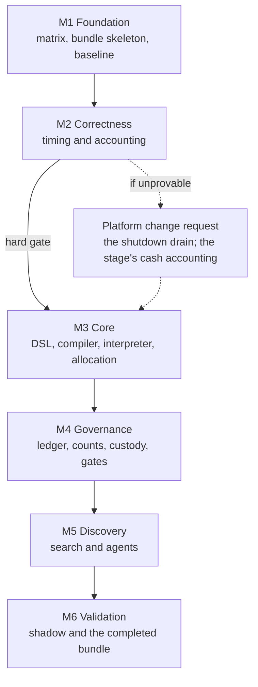

# Strategy discovery: implementation plan

This is the companion implementation plan for `docs/design/strategy_discovery_design.md`. The design
document states what the capability is, why each decision was taken, and which invariants and
acceptance criteria bind it. This document states how the work is sequenced, what each milestone
delivers, which fixture proves each claim, and what evidence has to exist before any criterion may be
reported as passing.

It authorises no work by itself. Under this repository's working agreement, an agent makes code
changes only for defects, and features require the owner to change that agreement first. This plan is
the input to that decision, and the release gates below stay closed until the evidence exists.

The plan follows one rule above all others, which the design document states and the reviews repeat:
**do not enable strategy discovery simply because the DSL or the agent layer is ready.** A working
compiler and a working agent are capabilities, not evidence.

## 1. Status and scope

| Item                       | State                                                                                                                                                                                                                    |
| -------------------------- | ------------------------------------------------------------------------------------------------------------------------------------------------------------------------------------------------------------------------ |
| Design baseline            | `docs/design/strategy_discovery_design.md`, fourth revision, with eighteen decisions and twenty-two acceptance criteria                                                                                                  |
| Authorised work            | M1 to M6, milestone by milestone and each on the owner's request. M1 to M5 are complete and pushed and M6 is complete; this plan authorises nothing by itself                                                            |
| This document              | Implementation planning: workstreams, deliverables, fixtures, exits, and the two evidence skeletons                                                                                                                      |
| Code written for discovery | The package `python/nautilus_trader/discovery/` holds fourteen modules, a prompt set and a facade of 249 exports, with the unit, integration and acceptance fixtures each milestone's exit records                       |
| Kernel changes             | None proposed. Where one is required, this plan says so and requests it rather than working around it                                                                                                                    |
| Release posture            | Closed for live trading. The search is enabled only behind M4's governance and M5's controls, and M6's shadow evidence is evidence about integration and operational behaviour rather than proof of future profitability |

In scope: the sequencing of M1 to M6, the module and test layout, the fixture set that each
acceptance criterion needs, the evidence model, and the failure paths when a prerequisite cannot be
proved.

Out of scope: implementing any of it, changing engine semantics, adding a crate, a PyO3 binding or a
generated stub, and any claim about profitability. Section 20 lists the boundaries in full.

### 1.1 The release rule

Five steps, taken in order, each with an exit that is evidence rather than a status.

| Step | Milestone | Exit                                                                                                            |
| ---- | --------- | --------------------------------------------------------------------------------------------------------------- |
| 1    | M1        | Every composition point the design names is verified by a fixture, and untested capabilities are marked blocked |
| 2    | M2        | Event timing and corporate-action accounting are proved, or the upstream changes they need are identified       |
| 3    | M3        | Interpreter, feature and allocation parity are proved                                                           |
| 4    | M4        | Ledger integrity, the statistical-input mappings, and confirmation custody are proved                           |
| 5    | M5        | Agent-driven search is enabled, and only then                                                                   |

M6 adds shadow evaluation, which is evidence about integration and operational behaviour and is not
proof of future profitability.

## 2. Provenance and inputs

| Input                                   | Role                                                                                                             |
| --------------------------------------- | ---------------------------------------------------------------------------------------------------------------- |
| `purposal/research1.md`, `research2.md` | The original proposals, read as requirements                                                                     |
| `purposal/research3.md`                 | The revised proposal, read as the revision of the first two                                                      |
| `purposal/feedback.md`                  | First review: six blocking findings and ten further issues, dispositioned in design Section 3.2                  |
| `purposal/feedback2.md`                 | Second review: five release tests and two subtle risks, dispositioned in design Section 3.3                      |
| The third review                        | Supplied with the request that created this document rather than as a file, and folded into Sections 4, 5 and 13 |
| This document's parent                  | `docs/design/strategy_discovery_design.md`, which remains the authority on decisions SD1 to SD18                 |

The third review's substance is small and specific, and it is implemented here rather than restated.
It closes the architecture review loop, accepts that the design now specifies what evidence is
required rather than only what must be correct, and asks for three implementation details to be
locked down: the conditions under which a PBO matrix is unusable (Section 5), the tamper-evidence and
re-verification rules for the evidence bundle (Section 4.3), and the distinction between a blocked
criterion and a failed one (Section 4.2), including preservation of the expected pre-enforcement
failure for settlement.

Reproduction: every command this plan refers to is listed in Section 16, and every claim a milestone
makes is meant to be reproduced from a fixture whose inputs, seeds and policy digest are recorded.
What cannot be reproduced is named as such: a model invocation is replayed from its recorded response
rather than recalled, and a shadow period is not reproducible at all.

## 3. Ground rules

Carried from the design document, and binding on every workstream.

| Rule                                                                                                             | Source                                              |
| ---------------------------------------------------------------------------------------------------------------- | --------------------------------------------------- |
| The discovery layer proposes and decides nothing; no component computes an authoritative number                  | Design invariant 1                                  |
| No primitive already in the repository is reimplemented                                                          | Design invariant 2, SD2                             |
| Candidates are data; executed code comes only from the compiler's interpreter                                    | Design invariant 3, SD3                             |
| Identity is content, for studies, trials, candidates, specifications and evidence                                | Design invariant 4                                  |
| Pre-registration outranks discovery; the search cannot read or write a frozen object                             | Design invariant 5, SD7                             |
| The trial inventory is complete and multiplicity is counted precisely                                            | Design invariant 6, SD6                             |
| The confirmation set is a campaign-level resource                                                                | Design invariant 7, SD7                             |
| Determinism where it is claimed; candidate logic reads no operating-system clock                                 | Design invariant 8                                  |
| Execution authority is absent, not disabled                                                                      | Design invariant 9, SD13                            |
| Nothing enters the kernel                                                                                        | Design invariant 10                                 |
| Placement is a pure-Python subpackage with no new runtime dependency, no crate, no binding and no generated stub | SD1                                                 |
| Recovery, registration and reconciliation follow the protocol in design Section 8.4                              | SD5                                                 |
| No test-only behaviour, branch, attribute or interface is added to production code                               | Working agreement, `AGENTS.md`                      |
| Prices, quantities, money and fees keep exact arithmetic                                                         | Working agreement, `AGENTS.md`                      |
| Tests do not depend on adapter environment variables                                                             | Working agreement, `scripts/strip-adapter-env.bash` |

Two prohibitions follow from the release rule and are worth stating separately, because both are the
kind of shortcut that looks like progress: a milestone may not be marked complete because a later
milestone's work makes it easier, and a criterion may not be marked passing because its design
section exists.

## 4. The evidence model

### 4.1 The bundle entry

Design Section 15.1 specifies six fields. The third review's requirements add two, because an entry
has to say which exact artifact it vouches for and what outcome it expected.

| Field           | Contents                                                                                                                        |
| --------------- | ------------------------------------------------------------------------------------------------------------------------------- |
| Criterion       | Its number and requirement, quoted from the design rather than paraphrased                                                      |
| Identity        | The digest that scopes the entry: test module, fixture, policy version, engine build and data snapshot, composed into one value |
| Test or fixture | The identifier of the test, fixture or campaign, with the file that contains it                                                 |
| Procedure       | The command or reproducible procedure, with its inputs, seeds and versioned policy                                              |
| Expected        | What the outcome should be. Most entries expect a pass; a fixture whose purpose is to detect a defect expects a failure         |
| Observed        | What happened, with the differing values where they differ                                                                      |
| Receipts        | The run receipt, artifact digests, engine build and policy digest the entry was produced under                                  |
| Status          | `passed`, `failed`, `blocked`, or `superseded`, with the dependency for a block and the defect for a failure                    |

The `Expected` field is what makes the settlement evidence honest, and it is treated as part of the
criterion rather than as a note: a fixture that plants an unsafe timing behaviour is expected to
fail, and reporting it as a failure would be a misreading of the criterion rather than a defect in
the system.

### 4.2 Blocked is not failed

The two mean different things and must not be collapsed.

| Status  | Means                                                                                                                      | Example                                                             |
| ------- | -------------------------------------------------------------------------------------------------------------------------- | ------------------------------------------------------------------- |
| Blocked | There is not yet enough implementation or evidence to evaluate the requirement. Nothing is claimed                         | Criterion 10 while the run receipt of SD16 does not exist           |
| Failed  | The requirement was evaluated against a real fixture, and the observed behaviour did not meet its pass condition           | A settlement fixture where a fill occurs at an ineligible timestamp |
| Passed  | The requirement was evaluated against the exact identity in the entry, and the observed behaviour met its expected outcome | The enforced timing contract holding against the same case table    |

An expected failure is neither of those two statuses in the ordinary sense: it is a passing fixture
whose purpose is to demonstrate that a defect is detectable. Section 13 states the pair explicitly for
settlement, where the same contract is exercised twice, once against the uncorrected behaviour and
once against the corrected one, and both results are retained.

### 4.3 Identity, tamper-evidence and re-verification

The third review asks that the bundle be tamper-evident and that a result be tied to the exact
artifacts it was produced from. The design's content-addressed identity already provides the
mechanism, so this is an application of it rather than a new design.

- An entry is keyed by the identity of Section 4.1, and its status is a statement about that identity
  alone. A passing entry says: this fixture, this policy, this engine build and this data snapshot
  produced this observed result.
- When a test, a fixture, the policy, the engine build or the data snapshot changes, the identity
  changes. The previous entry is retained as `superseded`, and it remains auditable, but it does not
  establish that the new version passes. The new identity starts `blocked` until it is run.
- The bundle is a derived artifact of the ledger, so its entries cite receipts the ledger holds, and
  a reader can re-run a procedure and compare rather than take the entry's word for it. An entry whose
  receipt or artifact digest does not resolve is `failed`, not `blocked`, because the evidence was
  claimed and cannot be produced.
- A criterion's current status is the status of its entry for the current identity. Old entries are
  history and are never consulted to answer whether the current implementation passes.
- The bundle is verified by a check rather than by inspection: the schema is validated, every identity
  is recomputed from the artifacts it names, and every receipt is resolved. A bundle that fails that
  check is not evidence for anything, including itself.

### 4.4 What the bundle is not

It is not a scorecard, and it is not a substitute for reading a fixture. It is not a place to record
an intention, a plan or a design reference: an entry exists because a test ran. And the document
hygiene checks of Section 16, however many pass, are not entries in it.

## 5. Statistical-input decisions at implementation time

### 5.1 When the PBO matrix is unusable

Design Section 7.7 requires incomplete and failed runs to be accounted for rather than silently
omitted. The third review asks for the conditions to be sharper, and they are, as four states that the
implementation must distinguish and report.

| State                            | Definition                                                                                                                            | Reported as                                                                                   |
| -------------------------------- | ------------------------------------------------------------------------------------------------------------------------------------- | --------------------------------------------------------------------------------------------- |
| Ineligible                       | The configuration fails a rule that was fixed before the matrix was built, such as a failed data-integrity gate or a policy violation | Excluded, with the rule that excluded it named in the report                                  |
| Eligible but failed              | The configuration was admissible, and its run failed economically, timed out, or produced no comparable observation                   | Excluded from the statistic and retained in the trial inventory, with its failure class named |
| Valid with documented exclusions | The remaining matrix still satisfies the procedure's preconditions, and each exclusion is accounted for                               | Computed, with the exclusions and their classes reported beside the result                    |
| Not computable                   | Too much of the matrix is missing, or the surviving rows are not comparable on a common index                                         | Not computable. No statistic is produced                                                      |

The last row is the one the review names as the failure mode to prevent: a PBO value that looks valid
but was computed on a conveniently selected subset is worse than no value, because it carries the
authority of a number. The implementation therefore evaluates the matrix against its preconditions
before computing, not after, and the result of that evaluation is itself reported.

Three further rules apply to this statistic while it remains a diagnostic, which is its status under
SD8: it never rejects a candidate, its exclusions are visible in the evidence package, and a change to
its eligibility rule is a change to the versioned mapping, which changes the identity of every entry
that depended on it.

### 5.2 The other two methods

The deflated Sharpe ratio and the admission assessment follow the same mapping requirement, and their
implementation rules are the ones in design Section 7.7: the return series, frequency, selection
universe and effective trial-count methodology are recorded for the estimator; the raw configuration
count and the effective count are separate numbers for the assessment; and a missing input produces
`INCONCLUSIVE` or `REJECT` rather than a manufactured value. The plan adds only the mechanical
consequence: both consume their inputs through one implementation of the mapping, so that a method
cannot quietly define its own counting rule.

### 5.3 The four counts and their mapping rules

Fixed before any count is taken, which is M1.5's deliverable. The rules are versioned
`discovery.counts/v1` and digest-pinned with the campaign policy, so a result records which mapping
produced it, and a change to any row below changes the identity of every entry that depended on the
mapping (Section 4.3).

The ledger recognises the event kinds below, and no other event changes a count.

| Event kind                                                | Recorded when                                                                                                    | Effect on the counts                                                                         |
| --------------------------------------------------------- | ---------------------------------------------------------------------------------------------------------------- | -------------------------------------------------------------------------------------------- |
| `proposal_recorded`                                       | A proposal arrives from an agent or an operator, before any validation                                           | `proposal_attempt_count` +1                                                                  |
| `specification_refused`                                   | The validator or the compiler refuses a proposal                                                                 | None. The refusal is recorded, and it is not a statistical trial                             |
| `compilation_recorded`                                    | A specification compiles and its behavioural identity is computed                                                | `unique_configuration_count` +1 when that identity is new under the equivalence rule, else 0 |
| `equivalence_merge`                                       | The policy's equivalence rule merges a new identity into an existing configuration                               | None, and both identities are recorded beside the merge                                      |
| `job_submitted`                                           | The orchestrator submits a job carrying its idempotency key                                                      | None                                                                                         |
| `execution_attempt_closed`                                | A worker closes an attempt: completed, economically failed, errored, timed out, or crashed                       | `executed_experiment_count` +1, whatever the outcome                                         |
| `registration_verified`                                   | The artifact exists, its digest verifies, and the run identity reconciles against the receipt                    | None by itself; it is the precondition for the row below                                     |
| `trial_admitted`                                          | A verified execution enters the statistical inventory of its selection process                                   | `statistical_trial_count` +1                                                                 |
| `registration_incomplete`                                 | Registration failed part-way                                                                                     | None, now or later. An incomplete record is never counted and never completed by inference   |
| `duplicate_registration`                                  | A second registration arrives under an existing idempotency key                                                  | None. Every count is unchanged, which is what idempotent means here                          |
| `gate_verdict`, `custody_event`, `search_policy_recorded` | A gate returns a verdict, a holdout reservation or access happens, a generation records its search-policy digest | None. These are evidence and lineage, not multiplicity                                       |

| Count                        | Definition in force                                                        | Increments only on                                                     | Explicitly not                                                                 |
| ---------------------------- | -------------------------------------------------------------------------- | ---------------------------------------------------------------------- | ------------------------------------------------------------------------------ |
| `proposal_attempt_count`     | Every proposal from an agent or an operator, compiled or not               | `proposal_recorded`                                                    | A refused proposal is counted here and nowhere else                            |
| `unique_configuration_count` | Distinct configurations under the pre-registered equivalence rule          | `compilation_recorded` with a behavioural identity new under that rule | A duplicate execution adds nothing, even when it reruns the same configuration |
| `executed_experiment_count`  | Every attempt that closed, whatever its outcome                            | `execution_attempt_closed`                                             | A job submitted and never started, and a duplicate registration                |
| `statistical_trial_count`    | Verified executions admitted to the relevant statistical selection process | `trial_admitted`                                                       | A refusal, an incomplete registration, and any result that has not verified    |

Five rules bind that arithmetic, and they are the ones M4.2 implements and criterion 7 tests.

- Nothing is counted before it verifies. Only `registration_verified` admits a record to any
  statistical use, so an unverified result is recorded and not counted.
- Raw and effective are separate numbers and are never substituted for each other. The assessment
  receives both, and the deflation receives the effective one with the methodology that produced it.
- A crash or a timeout counts conservatively. The attempt stays in the execution count, it enters the
  statistical inventory as a failure, and it is never given a fabricated or imputed return. A campaign
  whose failure rate leaves the statistical count uncertain is `INCONCLUSIVE` on that ground alone.
- A configuration that ran and failed economically stays in the statistical inventory, because its
  return series is part of the maximum the deflation corrects for.
- Nothing resets. The counts include earlier generations and abandoned branches, and a campaign that
  continues a search over the same observations inherits, through its research family, what its
  predecessor spent against that data.

One reading is named rather than left to inference, because the design states it tersely: Section
7.7's "raw executed configuration count" is taken here as `unique_configuration_count`, since the
assessment's question is how many configurations were tried rather than how many times a machine ran,
and the two differ by design wherever a duplicate execution exists.

The methods then consume the mapping as follows, which is design Section 7.7 with its inputs pinned
to the events above.

| Method                              | What it consumes                                                                                                                         | Where the mapping supplies it                                                                                                                                      | When it cannot                               |
| ----------------------------------- | ---------------------------------------------------------------------------------------------------------------------------------------- | ------------------------------------------------------------------------------------------------------------------------------------------------------------------ | -------------------------------------------- |
| Deflated Sharpe ratio               | The return series and frequency per configuration, the selection universe, and the effective trial count with its dependence methodology | `trial_admitted` records of the selection process, the campaign's declared universe at admission, and `statistical_trial_count` under the declared dependence rule | `INCONCLUSIVE`, naming the missing input     |
| Probability of backtest overfitting | The eligible set, the common index its rows share, and the representation of failures                                                    | The four states of Section 5.1 applied to the admitted set, and the fold layout's common index                                                                     | Not computable, and no statistic is produced |
| Admission assessment                | The raw configuration count and the effective count as separate numbers, with the uncertainty in the estimated power                     | `unique_configuration_count` and `statistical_trial_count` under the same dependence rule                                                                          | `REJECT`, never a defaulted number           |

Both of the first two consume their inputs through one implementation of this table rather than one
per method, which is the mechanical consequence Section 5.2 states.

## 6. Package layout and interfaces

Placement is SD1: a pure-Python subpackage beside the repository's other research Python, with tests
in the existing test tree. No file outside the new package and its tests is expected to change, and a
workstream that finds it must change one reports that as a finding rather than proceeding.

| Module                  | Owns                                                                            | Composes                                                           | Tests                                   |
| ----------------------- | ------------------------------------------------------------------------------- | ------------------------------------------------------------------ | --------------------------------------- |
| `discovery/schema.py`   | The closed specification schema, its versioning and its migration rules         | Nothing; standard library only                                     | `tests/unit/discovery/test_schema.py`   |
| `discovery/validate.py` | The compiler's five stages, their refusals and the structured result            | `schema.py`, the feature registry adapter                          | `tests/unit/discovery/test_validate.py` |
| `discovery/features.py` | The feature-value contract of design Section 9.6                                | The research crate's panel, features, labels, operators            | `tests/unit/discovery/test_features.py` |
| `discovery/compile.py`  | Specification to compiled plan, with both identities                            | `validate.py`, `features.py`                                       | `tests/unit/discovery/test_compile.py`  |
| `discovery/strategy.py` | The interpreter: the only executor, plus the allocation function                | `Strategy`, `submit_signals`, `TargetPipeline`, `TargetReconciler` | `tests/unit/discovery/test_strategy.py` |
| `discovery/run.py`      | One backtest per experiment, receipt capture, failure capture                   | `BacktestRunner`, `CanonicalRun`, `execute_experiments`            | `tests/unit/discovery/test_run.py`      |
| `discovery/ledger.py`   | The append protocol, the four counts, lineage, the bundle as a derived artifact | `ExperimentStore`, `digest_of`, `StudyIdentity`, `TrialIdentity`   | `tests/unit/discovery/test_ledger.py`   |
| `discovery/policy.py`   | The pre-registered policy, its digests and its freeze rules                     | The optimization assumptions vocabulary                            | `tests/unit/discovery/test_policy.py`   |
| `discovery/gates.py`    | The gate service, the calibration suite, the admission assessment               | `significance.py`, `splits.py`, `stages.py`, `permutation.py`      | `tests/unit/discovery/test_gates.py`    |
| `discovery/custody.py`  | The confirmation state machine, reservations and access records                 | The ledger                                                         | `tests/unit/discovery/test_custody.py`  |
| `discovery/genome.py`   | The genome, its degrees of freedom and its canonical form                       | The specification schema                                           | `tests/unit/discovery/test_genome.py`   |
| `discovery/evolve.py`   | Enumeration, bounded mutation, recombination, deduplication, Pareto selection   | `search.py`'s enumeration contract, extended to genomes            | `tests/unit/discovery/test_evolve.py`   |
| `discovery/agents.py`   | The replaceable adapter, the five roles, invocation records                     | An injected callable; no vendor dependency                         | `tests/unit/discovery/test_agents.py`   |
| `discovery/shadow.py`   | The live-signal monitor, simulated fills, drift reporting                       | A live data adapter and the sandbox venue                          | `tests/unit/discovery/test_shadow.py`   |
| `discovery/config.py`   | The JSON configuration and its schema, as `optimize` has one                    | The existing `nautilus` command pattern                            | `tests/unit/discovery/test_config.py`   |
| `discovery/cli.py`      | The command front end                                                           | `config.py`                                                        | `tests/unit/discovery/test_cli.py`      |

Two constraints on all of it. The package must import without side effects and without network access,
because files under `python/nautilus_trader/` are collected by the test-collection hook. And it must
not reach for a binding when an existing public surface will do: the first task of M3 is to establish
which surfaces suffice, and a binding is proposed only where an integration matrix row proves they do
not.

Integration and acceptance tests live in the existing tree rather than beside the package, because
that is where this repository keeps cross-module evidence: `python/tests/integration/` for the
fixtures that span discovery and the platform, and `python/tests/acceptance/` for the bundle check
itself. Fixtures with known answers live under `python/tests/integration/fixtures/discovery/` unless
M1 finds a better home in the existing conventions, in which case the change is reported rather than
made quietly.

## 7. M1: foundation

Goal: turn the design's claims about what exists into verified composition points, and stand up the
evidence machinery before anything is measured.

| Workstream | Work                                                                    | Deliverable                                                                                                                                 |
| ---------- | ----------------------------------------------------------------------- | ------------------------------------------------------------------------------------------------------------------------------------------- |
| M1.1       | Fill the integration verification matrix, one row per composition point | Section 14, with the verification columns completed and each row citing a fixture                                                           |
| M1.2       | Build the acceptance-evidence bundle skeleton                           | Section 15 as a validated artifact: twenty-two entries, every one `blocked`                                                                 |
| M1.3       | Settle the run-identity join for the ledger, per SD16                   | A decision recorded in the ledger: receipt from the runner, or the narrow Rust-side verification step                                       |
| M1.4       | Settle the feature-access path                                          | A decision recorded in `features.py`: precomputed panel, Python feature surface, or a shared adapter, with the parity fixture's shape fixed |
| M1.5       | Fix the four count definitions and their mapping rules                  | The rules of design Section 10.5 written as the mapping of Section 7.7, before any count is taken                                           |
| M1.6       | Establish the reproducible baseline                                     | A short campaign over an existing fixture whose result is stable, used to detect later drift                                                |
| M1.7       | Write the fixtures the matrix rows need                                 | `tests/integration/fixtures/discovery/`, one fixture per verified row                                                                       |

Exit: every row of Section 14 has a fixture that proves it, or is marked `upstream change required`
with the reason; the bundle schema validates and reports every criterion blocked; the four decisions
above are recorded with their evidence; and the baseline campaign reproduces.

What must not start: any candidate language work, any metric work, any agent work. M1 is an inventory
that produces evidence, not a survey that produces prose.

M1's exit, and where each condition is met. Every row of Section 14 is fixture-proven or marked as
needing an upstream change, and the states are counted there. The bundle validates and reports every
criterion blocked, which `python/tests/acceptance/test_discovery_bundle.py` checks, including the
negative cases that give the check teeth. The four decisions are recorded with their evidence in
Section 14.1. And the baseline campaign reproduces, in the run and across separate processes. Nothing
that M1 forbids was started: no candidate language, no metric, no agent.

## 8. M2: correctness

Goal: prove the two prerequisites that make every later number meaningful. This milestone is the hard
gate, and it is the one most likely to end in a platform request rather than in code.

| Workstream | Work                                                            | Deliverable                                                                                         |
| ---------- | --------------------------------------------------------------- | --------------------------------------------------------------------------------------------------- |
| M2.1       | Establish the engine's actual event lifecycle on a bar callback | A recorded trace of bar dispatch, settlement and matching order                                     |
| M2.2       | Test the latency-model deferral                                 | `FX-M2-1` case A, with event ordering and fill timestamps observed                                  |
| M2.3       | Test the decision-bridge projection                             | `FX-M2-1` case B, same observations                                                                 |
| M2.4       | Run the planted case table against the uncorrected behaviour    | The pre-enforcement record, expected to fail, retained                                              |
| M2.5       | Run the same case table against the enforced contract           | `FX-M2-1` cases C to F: delayed availability, opening gap, missing bar and holiday, timestamp order |
| M2.6       | Reconcile corporate actions in value and in cash                | `FX-M2-2`: dividend, split, held through the ex-date, entries and exits at boundaries               |
| M2.7       | Check event-ordering invariants across the fixtures             | A test that out-of-order input is refused rather than repaired                                      |

Exit: design criteria 4 and 6 hold against the exact identities in their entries, the pre-enforcement
failure is retained and labelled, and the settlement mechanism is named as proved rather than assumed.

Failure path, which is the likely one: if neither the latency model nor the decision-bridge
projection enforces the contract, M2 does not compensate inside the DSL. It produces the trace that
demonstrates the gap, requests the settlement-schedule change, and stays open. Discovery stays blocked
for as long as that takes.

M2's exit, and where each condition is met. The milestone ends on the near side of that failure path:
one of the two candidate mechanisms enforces the contract, so the settlement schedule does not have
to change, and four smaller findings are named and carried instead. The fixtures are
`python/tests/integration/test_discovery_timing_contract.py` for `FX-M2-1`, thirteen tests, and
`python/tests/integration/test_discovery_corporate_action_accounting.py` for `FX-M2-2`, six tests.

| Question                                                      | Answer                                                                                                                                           | Evidence                                                                                                                 |
| ------------------------------------------------------------- | ------------------------------------------------------------------------------------------------------------------------------------------------ | ------------------------------------------------------------------------------------------------------------------------ |
| Can the compiler emit a deferral that the engine honours?     | Yes, the latency model                                                                                                                           | An intent submitted from `on_bar` is held to its arrival and settles at the first bar at or after it, never earlier      |
| Is the declared eligibility honoured in price as well as time | Only when the snapshot carries market data at that instant                                                                                       | With bar-only data a released intent is priced at a bar close; a quote at the eligibility instant prices it at the quote |
| Does the decision-bridge projection defer anything?           | No: it resolves eligibility and stamps the signal with it, and its submission path holds no clock                                                | The projected fill precedes the artifact's own resolved eligibility by the whole interval to the next session            |
| Is a fill fabricated where the case table forbids one?        | Yes: the shutdown drain settles a deferred intent against the last known close and does not notify the strategy                                  | The single-bar case reports a filled order with no market data after the arrival                                         |
| Is out-of-order input refused?                                | No: the stream is sorted by `ts_init` before dispatch, and the data engine's sequence validation changes nothing because it runs after that sort | The reordered-bar fixtures replay in ascending initialization order, with validation both off and on                     |

Criterion 4 is therefore proved for the mechanism the compiler will emit, and not proved as written.
The pre-enforcement half fails as the design requires, which is what makes the test discriminating:
with no deferral the fill carries the decision bar's own timestamp and that bar's own close. The
enforced half holds for the latency model. Two cases disagree with the table, the bridge path and the
shutdown drain, and the equality of eligibility in time with eligibility in price depends on the
snapshot rather than on the engine. The compiler-side half of case A, refusing a specification that
decides at a close and executes at it, cannot be evaluated before M3 and is carried there.

Criterion 6 does not hold, and its failure is now measured rather than expected. The accounting
fixture reconciles the value leg, which carries both actions, and cannot reconcile the cash leg: a
held position moves only by its purchase cost, the distribution it was entitled to is credited to
nothing, and a round trip across the boundary realises 20,000 where a total-return account of the same
position carries 19,750. The defect is the absent upstream dividend cash-flow path, which design
Section 18 question 3 and decision SD12 already name as the equity-readiness prerequisite, and the
equity-readiness statement stays withheld rather than softened.

One platform request follows, and one finding is corrected here rather than filed.

The request is the shutdown drain, and it was posted as a comment on upstream issue 5054
(<https://github.com/nautechsystems/nautilus_trader/issues/5054#issuecomment-6207459633>), with the
one-bar reproduction and the output it prints. Upstream closed that issue with `fad94f66b3`, which
leaves a due command pending when a portfolio snapshot timer is the only thing advancing the clock
and which states that shutdown retains its existing settlement behaviour. The drain is a documented
unrestricted settlement point, and the absent strategy notification is documented with it, so the
comment states the measurement and asks a question rather than reporting a discrepancy: a fill the
strategy never sees is a position it cannot account for, and the price is one the command could not
have reasoned from. The one-bar reproduction is
`python/tests/integration/test_discovery_timing_contract.py`, case
`test_a_deferred_intent_with_no_subsequent_market_data_is_filled_at_shutdown`.

The second is the dividend cash-flow path that criterion 6 needs, and it is not an upstream request.
The corporate-action stage is this fork's own work: `crates/backtest/src/adjustment.rs` and
`crates/model/src/data/adjustment.rs` are absent from upstream `develop`, upstream's
`crates/backtest/src/exchange.rs` carries no `CorporateAction` reference at all, and the two commits
that added the stage are in this fork's history and not upstream's. Upstream therefore has no
capability to change, and its own open request for the general case is issue 3307. The gap is
fork-side, closed by whoever owns the stage, and the capability row of Section 14 is where it is
recorded.

The decision on that gap is to leave it open rather than to close it here. Criterion 6 stays `failed`
for the reason the fixture measures, the equity-readiness statement stays withheld rather than
softened, and this plan's own response stands: claims are made on synthetic fixtures or on an
instrument subset whose accounting is known to be correct, and the limitation is reported with every
result. Crediting entitlements is a platform change inside the corporate-action stage, with the cash
ledger, the position quantity and the adjustment series all moving together and the reconciliation
having to agree with all three, so it is its own change rather than part of a discovery milestone;
and if the capability is ever wanted outside this fork, offering the stage upstream is the route
issue 3307 describes. The withholding is what the bundle already enforces: the criterion 6 entry
carries its measured failure and the accounting fixture pins the numbers it rests on.

M2 stays open on the request and the gap rather than on the timing contract, and the M3 blockage is not the
one SD15 describes. That rule fires when neither mechanism enforces the contract, and one does, so
the compiler emits a latency deferral and never the bridge pattern alone. The bridge remains useful
for what it does resolve, an artifact's availability, and its caller owns any waiting rather than the
projection. What M3 cannot proceed without is the owner's authorisation, which is per milestone, and
the compiler's refusal half of case A, which is its own work.

One status transition needs naming, because Section 4.2 lists criterion 6 as its example of a blocked
entry. That example predates a fixture existing. Now that one does and has been run without meeting
its pass condition, the status is `failed` by the same section's definition, which is an evaluation
against a real fixture, and the dependency that causes it is recorded as the defect rather than as
the block. Criterion 4 moves on the same reasoning, and the entries carry their identity, procedure,
expected and observed results and receipts in Section 15's bundle.

## 9. M3: core

Goal: build the language and the executor, and prove they agree with independent references before any
search uses them.

| Workstream | Work                                                              | Deliverable                                                                                                                                              |
| ---------- | ----------------------------------------------------------------- | -------------------------------------------------------------------------------------------------------------------------------------------------------- |
| M3.1       | Implement the closed schema with versioning and migration rules   | `schema.py`, with refusals for unknown fields, out-of-bound values and old versions                                                                      |
| M3.2       | Implement the compiler's five stages and the structured result    | `validate.py`, `compile.py`, with warnings and resolved feature versions                                                                                 |
| M3.3       | Implement the feature-value contract and its parity fixture       | `features.py`, `FX-M3-4`: offline and decision-time values agree on value, timestamps, warm-up, missing values, units and membership                     |
| M3.4       | Implement the interpreter                                         | `strategy.py`, one executor, no generated code, injected via `add_strategy`                                                                              |
| M3.5       | Implement the allocation function and its nine declared decisions | `FX-M3-5`: ranking ties, missing feature, halted security, caps binding, partial fill, cash constraint, short selection, a position leaving the universe |
| M3.6       | Build the reference-strategy set and run the differential tests   | `FX-M3-3`: seven reference strategies against hand-written fixtures                                                                                      |
| M3.7       | Demonstrate the whole path on a hand-written candidate            | `FX-M3-1`: compile, run, evidence package, ledger entry, no manual step                                                                                  |
| M3.8       | Demonstrate that a specification cannot name code                 | `FX-M3-2`: refusals for a module path, a code artefact and an expression                                                                                 |

Exit: design criteria 1, 3, 19, 20 and 21 hold, with parity differences inside a stated tolerance and
no difference hidden behind an unchanged specification identifier.

What must not start: search, evolution, or agents. M3 produces an executor, and an executor with no
admitted search space is used by a hand-written candidate and a fixture, not by a generator.

M3's exit, and where each condition is met. Each workstream landed as its own module in
`python/nautilus_trader/discovery/`, and each carries the fixture its row names.

| Workstream | Module                                 | Fixture                                                                         |
| ---------- | -------------------------------------- | ------------------------------------------------------------------------------- |
| M3.1       | `schema.py`                            | `python/tests/unit/discovery/test_schema.py`                                    |
| M3.2       | `validate.py`, `compile.py`            | `python/tests/unit/discovery/test_validate.py`, `test_compile.py`               |
| M3.3       | `features.py`                          | `FX-M3-4`: `python/tests/integration/test_discovery_feature_parity.py`          |
| M3.4       | `strategy.py`                          | `FX-M3-3`: `python/tests/integration/test_discovery_reference_strategies.py`    |
| M3.5       | `strategy.py`, the allocation function | `FX-M3-5`: `python/tests/unit/discovery/test_strategy.py`                       |
| M3.6       | the reference set                      | `FX-M3-3`, the differential fixture above                                       |
| M3.7       | the whole path                         | `FX-M3-1`: `python/tests/integration/test_discovery_round_trip.py`              |
| M3.8       | the closed schema                      | `FX-M3-2`: `python/tests/integration/test_discovery_generated_code_refusals.py` |

Two rows of Section 14 that M1 left `partial` are exercised in the composition M3 depends on. Row 1,
the point-in-time panel, has its availability semantics pinned by `FX-M3-4` rather than left to the
design. Row 16, the target pipeline, is driven from inside a strategy instance by `FX-M3-3`, which is
the supported path: the row's open question was whether the pipeline must be drivable outside a
strategy, and the interpreter shows that it need not be. Neither row's state changes here, because
what remains missing from them - the internals with no binding, and the feature compiler - is still
missing.

All five criteria hold, at the identities their bundle entries carry. Criterion 1: the hand-written
payload compiles; the runner's experiment digest is derived from the plan rather than supplied to it;
the run returns the engine's own canonical result, `blake3:d0d0d6c8...`, and an evidence package
whose specification, behavioural, experiment and canonical digests equal the plan's and the run's;
thirty-two bars produce thirty-two decisions, twenty orders and twenty fills, every fill attributed
to the decision that produced its order; the metrics are defined numbers, Sharpe
9.364348220119131 and drawdown `-0.0`, because this candidate trades; and the ledger holds one entry,
named for the behavioural digest, whose recorded identities all equal the run's, and refuses a
rewrite. Criterion 3: every code shape is refused at the field that carries it, and one compilation
runs with every dynamic import recorded and the recording empty. Criterion 19: seven reference
strategies agree with expectations written down before they were run - the ranking and threshold
selections, two rebalance decisions across twelve daily periods, a holding-period exit at `S + 2` and
`S + 4` with none at `S + 1` or `S + 3`, the allocated weights and the strengths derived from them,
nothing happening at all when no instrument is eligible, and a gap fill twenty units below the stop
threshold it crossed. Criterion 20: the research and decision-time values agree on value, on both
timestamps, on unit and on identity, and the warm-up, the availability lag, the absent value and the
membership boundary are each measured rather than assumed. Criterion 21: every one of the nine
decisions has a case that fails if its rule is reversed, and three calls over one request produce
identical targets with the request itself unchanged.

Five findings are carried out of the milestone, and each is recorded rather than repaired silently.

The first is a narrowing of SD14, which the design now states: the platform's only handoff from a
strategy to the target pipeline is `Strategy.submit_signals`, and a `Target` is not an input to that
pipeline. A candidate's allocation therefore decides a target weight and realises it as the signal's
strength, scaled by the portfolio's own position cap, so the declared weight is carried and quantity
resolution stays the platform's. The allocated `Target` values remain the decision's own record, and
no second submission path was introduced to carry them.

The second and third are interpreter defects the differential fixtures exposed, both of which would
have presented themselves as a strategy result rather than as an interpreter fault. The holding-period
cap was counted in bar events, so a cap of two expired part-way through a period whenever the
cross-section held more than one instrument; it is now counted in the declared signal frequency's
decision periods, from the decision that opened the position. And the rebalance period was keyed from
the strategy clock rather than from the decision's own instant, which is a different quantity and
would have keyed a live decision by whatever moment its handler ran at. Both fixes are in
`strategy.py`, both are stated in the design's Section 9.7, and `FX-M3-3` asserts against them.

The fourth is a refusal code with no rule. `HOLDING_PERIOD_BELOW_REBALANCE` is declared in the closed
refusal vocabulary and the design's semantic stage names the interaction it belongs to, but no stage
emits it, and the comparison it names is calendar-dependent: a month is not a fixed number of
decision periods, so the compiler cannot decide it soundly. The interaction is resolved instead by
the interpreter's own stated rule, that a rebalance does not restart a holding period, and the code
is left unemitted rather than given a rule that would refuse valid candidates. It is carried to the
M4 review as a vocabulary question rather than as a defect.

The fifth is a convention rather than a finding, and it is recorded because it is visible in the
ledger: a metric that is not a finite number is written as its own text, which is what the existing
experiment store does. A run whose Sharpe ratio is undefined for its sample is a real outcome, and a
record that could not be serialised would lose the run rather than the value.

One observation is carried as an open question rather than as a finding, because the design does not
decide it and a fixture must not decide it for the design. A decision is taken per bar event, so a
cross-section of four daily instruments produces four decisions - and therefore four rebalances under
a `daily` frequency - in each decision period. Two consequences are visible in the reference fixture:
the first decision of a period reads that period's value for the instrument whose bar has arrived and
the previous period's value for the others, and a holding whose cap expires in a period can be
re-entered later in that same period. Neither is look-ahead, because every value is the latest
available at its own decision instant, and the second follows from the language's own rules applied
to the current definition of a rebalance bar. Both change a candidate's realised turnover, so the
question is carried to the search milestone rather than settled silently here: whether a decision
period should carry one decision rather than one per bar event, and if so what makes a period's
cross-section complete.

## 10. M4: governance

Goal: make the ledger, the counts, the custody rules and the gates trustworthy, and calibrate the gate
before it is allowed to reject anything.

| Workstream | Work                                                                                             | Deliverable                                                                                                                                                           |
| ---------- | ------------------------------------------------------------------------------------------------ | --------------------------------------------------------------------------------------------------------------------------------------------------------------------- |
| M4.1       | Implement the append protocol: one writer, idempotency keys, registration states, reconciliation | `ledger.py`, with the protocol of design Section 8.4                                                                                                                  |
| M4.2       | Implement the four counts and the versioned statistical mapping                                  | The mapping of Section 5 here, consumed by every method that needs a count                                                                                            |
| M4.3       | Implement lineage: candidate parentage, campaign lineage, research-family identity               | `FX-M4-3`: counts and lineage over a campaign with a duplicate, a crash and a refusal                                                                                 |
| M4.4       | Implement the confirmation state machine and the reservation records                             | `FX-M4-5`: the five negative cases, including a new branch expecting fresh access                                                                                     |
| M4.5       | Implement the receipt, the reconciliation check and the fail-closed rule                         | `FX-M4-8`: interruptions before registration, during persistence, after registration, during duplicate submission, two concurrent registrations, one tampered receipt |
| M4.6       | Implement the evidence package and the recomputation check                                       | `FX-M4-1` and `FX-M4-6`: numbers recompute, and every envelope reference resolves                                                                                     |
| M4.7       | Implement the gate service, the transition table and the status vocabulary                       | The lifecycle table of design Section 11.4, with illegal transitions refused                                                                                          |
| M4.8       | Implement the admission assessment and its report                                                | `FX-M4-4`: an over-budget plan, a `REDUCE` case, a `REJECT` case, and an unestimable input rejected rather than defaulted                                             |
| M4.9       | Assemble and run the calibration suite                                                           | `FX-M4-7`: null, positive, leakage, cost, concentration, parameter-spike and accounting controls, with the detected and missed sets reported                          |
| M4.10      | Implement the PBO matrix evaluation and its four states                                          | `FX-M4-9`: a matrix that is valid with exclusions, and a matrix reported as not computable                                                                            |

Exit: design criteria 2, 7, 8, 9, 10, 11 and 18 hold, the mapping is versioned and testable, and the
gate's false-accept and false-reject behaviour on the calibration suite is reported. Whether PBO is
promoted from diagnostic to gate is decided here, on that report, and the default is that it is not.

M4's exit, and where each condition is met. The three modules the plan's Section 6 names own the
milestone, and each carries its own unit tests; the fixtures that span the milestone are one
integration module, because each is a campaign rather than a module's behaviour.

| Workstream | Module                                                                        | Fixture                                                             |
| ---------- | ----------------------------------------------------------------------------- | ------------------------------------------------------------------- |
| M4.1-M4.2  | `ledger.py`: the append protocol, the four counts and the versioned mapping   | `python/tests/unit/discovery/test_ledger.py`, `FX-M4-3`, `FX-M4-8`  |
| M4.3       | `ledger.py`: lineage and the research family                                  | `FX-M4-3`: `python/tests/integration/test_discovery_governance.py`  |
| M4.4-M4.5  | `custody.py`, `ledger.py`: custody, reservations, receipts and reconciliation | `python/tests/unit/discovery/test_custody.py`, `FX-M4-5`, `FX-M4-8` |
| M4.6       | `ledger.py`: the envelope and the recomputation                               | `FX-M4-1`, `FX-M4-6`, and the bundle check's identity recomputation |
| M4.7-M4.8  | `gates.py`: the gate service, the lifecycle and the admission assessment      | `python/tests/unit/discovery/test_gates.py`, `FX-M4-4`              |
| M4.9-M4.10 | `gates.py`: the calibration suite and the overfitting matrix                  | `FX-M4-7`, `FX-M4-2`, `FX-M4-9`                                     |

The gate service reads its policy and nothing else, and every threshold, limit and cost is declared
there: the deflated Sharpe floor, the net Sharpe floor, the margin over the baseline, three
concentration ceilings, the neighbourhood tolerance and its required agreement, the drawdown limit,
the positive-fold share and the share of closed attempts that may produce no usable return series.
The service records each verdict through the campaign inventory, stops at the first gate that does
not pass, and reports the verdicts it reached rather than the gates it never asked.

Six of the milestone's eight criteria hold, and the two that do not are measured rather than
expected.

Criterion 7 holds over a campaign with a deliberate duplicate, a deliberate crash and a deliberate
refusal: the four counts are separate, the crash stays in the execution count and is never given an
imputed return, the lineage names the candidate, its campaign, its research family and the recorded
invocation, a duplicate submission changes no count, and an illegal transition is refused in both the
registration protocol and the lifecycle table. Criterion 8 holds with its arithmetic: the assessment
admits a plan that fits, narrows one that does not to the configuration count that does, refuses data
that cannot support the claim at any allocation, and refuses a plan whose cross-trial dispersion
cannot be estimated rather than defaulting one. Criterion 9 holds with the five negative cases
refused by code, the reservation spent once and never released, the verdict bound to the frozen
candidate, and a worker environment that names the confirmation root reported. Criterion 11 holds on
the calibration suite: the null, positive, leakage, cost, concentration, parameter-spike and
accounting controls are each detected by the gate that carries them, with no false accept and no
false reject at the pre-registered thresholds, and a control the chain passes is reported as missed
rather than raising. Criterion 18 holds under interruption before registration, during persistence,
after registration and during duplicate submission, with two concurrent registrations admitting one
trial and a tampered receipt failing closed. Criterion 2's recomputation holds for the counts, the
entry identities and the declared non-deterministic components, and criterion 10's envelope resolves
every reference it declares.

| Criterion | Status | What the entry records                                                                               |
| --------- | ------ | ---------------------------------------------------------------------------------------------------- |
| 2         | Failed | The recomputation agrees, but the seed, build and configuration join of decision M1.3 does not exist |
| 7         | Passed | Four separate counts, lineage, idempotency and refused illegal transitions over one campaign         |
| 8         | Passed | `ADMIT`, `REDUCE`, `REJECT` and an unestimable input, each with its arithmetic and its sensitivity   |
| 9         | Passed | The five negative cases, the spent reservation, the bound verdict and the worker-environment check   |
| 10        | Failed | The envelope resolves, but the engine's canonical digest cannot be recomputed from retained bytes    |
| 11        | Passed | Seven classes of control, detected and missed sets reported, PBO left as a diagnostic                |
| 18        | Passed | Interruption, concurrency, repetition, a tampered receipt and a checkpoint outside the write path    |

Criterion 5 is satisfied by the same suite: the planted defects of `FX-M4-2` are the leakage, cost,
concentration and parameter-spike controls, and each is caught by the gate the design names for it.
The bundle's entries for criteria 2 and 10 are therefore `failed` rather than blocked, which is
Section 4.2's definition: both were evaluated against a real fixture and neither met its pass
condition, and each names the defect that causes it.

Seven findings are carried, and each is recorded rather than repaired silently.

The first is a gap in the mapping. The four counts, the admitted trials, the failure classes and the
data roles are read from the ledger, which is what makes the deflation's multiplicity auditable; the
per-trial return series and Sharpe estimates are not, because an entry retains the engine's canonical
document, which Python cannot deserialise, and the analysis crate's Sharpe is annualised while the
correction is per-period. The gate therefore consumes those inputs as declared evidence at M4, and
retaining a per-trial return series is an M5 input-list item rather than a change to the entries'
identity.

The second is the receipt's authority. Reconciliation compares every joined field and fails closed,
but until decision M1.3's narrow upstream change exists, the manifest it compares against is the one
the caller declares. The check is real and its tampered-receipt fixture is discriminating; what it
cannot yet claim is that the manifest is the engine's own.

The third is what cannot be recomputed, and it is what makes criteria 2 and 10 `failed`. The
extension computes the engine's canonical blake3 digest from the document it holds and exposes no
surface that recomputes it from retained bytes, so the ledger records both the digest and the
document's SHA-256 and the recomputation verifies the latter. A narrow Rust-side hashing step, in the
shape SD16 prefers, would close it.

The fourth is a narrowing rather than a defect. Custody permits a replacement candidate's read only
under an exploratory label, which travels with the access record and consumes nothing, and a
successor campaign inherits its family's spent reservation through a declared input read from its
predecessor's inventory rather than from a shared file. The design's rule that a branch inherits its
family's confirmation history is therefore enforced by the caller declaring what it inherited, not by
a store the two campaigns share.

The fifth is the admission relation's limits, and they are stated in every report rather than
inferred from a status: the relation is a significance relation and not a power calculation, so the
declared power is an assumption the assessment cannot verify; the published minimum-backtest-length
relation is inverted by searching the correction the repository already computes rather than by a
second implementation of its quantiles; and the declared cross-trial dispersion is realised by a
symmetric set of trial estimates whose sample variance is exactly that dispersion squared, because
the correction consumes the dispersion rather than the estimates.

The sixth is the overfitting matrix's status. It is evaluated against its preconditions before it is
computed, its four states are reported with their exclusions, and it rejects nothing: nothing in the
gate chain reads it, and the decision the design reserved - whether to promote it from diagnostic to
gate - is not taken on a matrix that reports `not computable` for realistic inventories.

The seventh closes the vocabulary question M3 carried. `HOLDING_PERIOD_BELOW_REBALANCE` is removed
from the closed refusal vocabulary, because no stage could emit it soundly and the interaction it
named is resolved by the interpreter's own rule, which the design states: a holding-period cap is
counted in the decision periods of the declared signal frequency, and a rebalance that re-signals a
held instrument does not restart its holding period.

Two questions are carried rather than settled. The per-bar decision question is unchanged: a decision
is taken per bar event, so a period's first cross-section is partially updated and a holding whose
cap expires can be re-entered in that period, and whether a period should carry one decision is
still the search milestone's to answer. And the calibration suite's thresholds are now exercised
rather than tuned: the report states the detected and missed sets at the pre-registered values, and a
gate that cannot discriminate is a finding rather than a reason to move a threshold.

## 11. M5: discovery

Goal: enable generation and search inside an admitted space, with the controls already enforced.

| Workstream | Work                                                                          | Deliverable                                                                                                                     |
| ---------- | ----------------------------------------------------------------------------- | ------------------------------------------------------------------------------------------------------------------------------- |
| M5.1       | Implement the genome, its three degrees of freedom and its canonical form     | `genome.py`, with a mechanism change producing a new hypothesis and falsification statement                                     |
| M5.2       | Implement bounded mutation, recombination, deduplication and Pareto selection | `evolve.py`, reading development results only                                                                                   |
| M5.3       | Prove selection isolation                                                     | `FX-M5-2`: candidate A informs candidate B on the same partition, and B's result there is labelled development for that lineage |
| M5.4       | Implement the agent adapter, the five roles and the invocation records        | `agents.py` and `prompts/`, with a replayable response and no vendor dependency                                                 |
| M5.5       | Implement the structured-output validator and the refusal path                | `FX-M5-3`: an unstructured response, a schema violation and an insufficient-data outcome                                        |
| M5.6       | Implement the search-policy versioning and its mutable-field list             | The named mutable set of design Section 10.6, with a per-generation digest                                                      |
| M5.7       | Run a small admitted campaign end to end                                      | `FX-M5-1`: a campaign that ends inconclusive, with its reason and its trial inventory                                           |

Exit: design criteria 5, 14 and 17 hold, no agent can reach a metric, a threshold, the confirmation
set or an engine handle, and the search policy can report which version proposed which candidate.

M5's exit, and where each condition is met. Each workstream landed as its own module in
`python/nautilus_trader/discovery/`, and each carries the fixture its row names.

| Workstream | Module                                       | Fixture                                                        |
| ---------- | -------------------------------------------- | -------------------------------------------------------------- |
| M5.1       | `genome.py`                                  | `python/tests/unit/discovery/test_genome.py`                   |
| M5.2       | `evolve.py`                                  | `python/tests/unit/discovery/test_evolve.py`                   |
| M5.3       | `evolve.py`, `PartitionRoles`                | `FX-M5-2`: `python/tests/integration/test_discovery_search.py` |
| M5.4       | `agents.py`, `prompts/`                      | `python/tests/unit/discovery/test_agents.py`                   |
| M5.5       | `agents.py`, with `validate.py`              | `FX-M5-3`: the same integration module                         |
| M5.6       | `evolve.py`, `SearchPolicy`                  | the per-generation digest through `record_search_policy`       |
| M5.7       | the driver the integration fixtures exercise | `FX-M5-1`: the same integration module                         |

| Criterion | Result | Evidence                                                                                                                                                                                                           |
| --------- | ------ | ------------------------------------------------------------------------------------------------------------------------------------------------------------------------------------------------------------------ |
| 5         | holds  | M4's calibration suite is re-run over the merged tree, and the search adds no path that evades a gate                                                                                                              |
| 14        | passes | `FX-M5-1`: twelve observations against a twenty-observation contract reach G3, which returns inconclusive; the campaign records its reason and reports two executions, one admitted trial and one unusable attempt |
| 17        | passes | `FX-M5-2`: the partition A informed is development data for that lineage, B's validation attempt on it is refused by name, another lineage keeps the partition, and selection refuses a locked result              |

Five findings are carried rather than repaired silently. The three degrees of freedom are enforced by
construction rather than by review: the only operation that changes a mechanism takes the
replacement hypothesis and falsification statement as an argument, so no call can change the
mechanism and keep the old pair. The equivalence rule is pre-registered and names which
specification differences are a different configuration, so a rerun, a rename and a recompilation
cannot become several trials while a genuinely distinct configuration cannot vanish. The search
policy names its mutable set and refuses a frozen field by name, and the generation stamp travels
with the policy as a stamp rather than an instruction. The partition role is attached to a result
together with the lineage that consumed it, so the boundary survives a new branch or a new identity.
And the measurement: the per-period Sharpe ratios an attempt produced are declared when the attempt
closes and read back by `recorded_trial_sharpes`, so a correction that consumes the cross-trial
dispersion computes it from the inventory instead of being told it. The raw return series stays with
the run's canonical document, which Python cannot deserialise, and the ratios are per-period, which
is what the correction consumes.

Two limits are named. Four of the five roles are not candidate producers, so their responses are
checked for being a JSON object rather than against the language's schema; the authority that limits
them is the field set they are given, which is exact because a prompt declares its fields and
`Prompt.render` refuses any other. And agents still cannot be reproduced by recall: a campaign
replays a recorded response, which is why the invocation record is evidence and a live call is not.

The per-bar decision question is settled by declaring it rather than by changing the interpreter. A
decision is taken on every decision bar and only a rebalance bar allocates, so a holding-period cap
that expires inside a period closes the position on that bar and leaves the proceeds uninvested until
that period's rebalance bar. The design's Section 9.7 states it, and for `daily` every decision bar
is a rebalance bar, so the interval does not arise.

The discovery suites report 264 passed over `python/tests/unit/discovery` and the acceptance tree and
74 passed over `python/tests/integration -k discovery`, `ruff check` and `ruff format --check` are
clean, and the two bundle entries this milestone resolves carry component identities whose digests
recompute. `make` remains unusable in this environment, so every gate above was run directly.

## 12. M6: validation and shadow

Goal: exercise the frozen path, close the boundary, and report shadow as integration evidence.

| Workstream | Work                                                     | Deliverable                                                                                        |
| ---------- | -------------------------------------------------------- | -------------------------------------------------------------------------------------------------- |
| M6.1       | Run the end-to-end acceptance path on a frozen candidate | A complete evidence package, `FX-M6-4`                                                             |
| M6.2       | Assert the execution boundary                            | `FX-M6-1`: dependency assertion, capability allowlist, no credential, negative submission test     |
| M6.3       | Prove the shadow temporal contract matches the replay    | `FX-M6-2`: the same declared fields and the same timestamp pair in both                            |
| M6.4       | Run a shadow period on live data with simulated fills    | `FX-M6-3`: divergence report with the counts, discrepancies, non-fills and cost differences        |
| M6.5       | Complete and verify the bundle                           | Every criterion `passed`, `failed` or `blocked` with its dependency named, at the current identity |

Exit: design criteria 12, 13, 15 and 16 hold, the bundle is complete and validates, and the shadow
report is labelled as evidence about integration and operational behaviour rather than about
profitability.

### 12.1 What M6 produced

| Workstream | Module                                                                                                    | Fixture                                                               |
| ---------- | --------------------------------------------------------------------------------------------------------- | --------------------------------------------------------------------- |
| M6.1       | `ledger.py`: the gate reason, `gate_verdicts`, `CampaignAudit` and `audit_campaign`; `gates.py` writes it | `FX-M6-4`: `python/tests/integration/test_discovery_audit.py`         |
| M6.2       | the fixture, over `validate.py`'s closed schema and the repository's canonical credential list            | `FX-M6-1`: `python/tests/integration/test_discovery_boundary.py`      |
| M6.3       | `shadow.py`: `TemporalContract`, `TemporalReading`, `TemporalParity` and `temporal_parity`                | `FX-M6-2`: `python/tests/integration/test_discovery_shadow.py`        |
| M6.4       | `shadow.py`: `ShadowPlan`, `ShadowObservation`, `ShadowReport` and `shadow_period`                        | `FX-M6-3`: the same integration module                                |
| M6.5       | the bundle, the facade and the bundle check                                                               | `FX-M1-3`: `python/tests/acceptance/discovery_acceptance_bundle.json` |

Unit tests: `python/tests/unit/discovery/test_shadow.py` for the contract, the observation-count rule
and the report, and two cases in `test_ledger.py` for the verdict reader and the audit.

| Criterion | Result | Evidence                                                                                                                                                                                                                                                                                                                                                                                                                                                                                                                       |
| --------- | ------ | ------------------------------------------------------------------------------------------------------------------------------------------------------------------------------------------------------------------------------------------------------------------------------------------------------------------------------------------------------------------------------------------------------------------------------------------------------------------------------------------------------------------------------ |
| 12        | passes | `FX-M6-1`: four tests. The graph resolved in a clean interpreter holds no adapter module and no export names an execution surface; the sandbox exports its execution client factory and config and no data client; the 91 variables of the canonical list reach neither the stripped environment discovery imports in nor a worker's; a proposal declaring `data.venue` is refused as `BLOCK_UNKNOWN_FIELD` and one declaring `universe.module_path` as `CODE_REFERENCE_REFUSED`, and both refusals are recorded and read back |
| 13        | passes | `FX-M6-2`: the candidate decides at the session open and declares `next_session_open`; the feed derives the eligible instant from the declaration and the observed series, the engine's fill records that same instant, and the two readings agree on the declared fields and on the pair. A reading declaring `same_session_close` reports `execution_eligibility` as the differing field, and a shifted reading reports the timestamps as differing                                                                          |
| 15        | passes | `FX-M6-3`: a late signal, a non-fill with its reason, two undelivered decisions and a cost difference of 0.25 are each a field of the report; it is labelled simulated, readable against a declared three and not readable against the count plus one, and its digest pins the plan it was declared under                                                                                                                                                                                                                      |
| 16        | passes | `FX-M6-4`: three candidates are reconstructed, including the refused one the lineage does not hold; one admitted trial stands against a crashed attempt left incomplete; the gate reasons are read back from the ledger and compared with the report the service returned; the policy digest is corroborated and the search-policy digest reported; the chain verifies against the audit's own head, and the reconstruction is deterministic and plain data                                                                    |
| 22        | passes | the bundle completes: twenty-two entries validate, eighteen pass with identities whose digests recompute, four are failed with their defects named, and none is blocked                                                                                                                                                                                                                                                                                                                                                        |

Five findings are carried rather than repaired silently. A gate verdict now records the reason it was
reached with, because the fact that a gate stopped a candidate and the reason it did are different
statements and only the second explains a rejection; the reason is evidence, so it changes no count
under the mapping of Section 5.3. The audit names candidates the lineage cannot, because a refused
proposal never compiles and a reader listing compiled candidates would lose exactly the candidates
that were turned away. A non-fill is an intended entry that did not fill, so an observation that
intended nothing is neither a fill nor a non-fill and a quiet period is not reported as divergence,
and a non-fill that gives no reason is refused rather than reported, because a report that cannot say
why is not diagnosable. The temporal contract is an explicit object rather than a convention, because
a declaration is part of identity: a contract whose `execution_eligibility` differs is a different
contract whatever the instants do, and the two halves of the comparison are reported separately
because they fail differently. And the environment assertion is over the environment the boundary
defines rather than over the operator's shell, because `EODHD_API_KEY` is set on this workstation and
the design states plainly that a machine with live credentials is protected procedurally: the fixture
asserts that discovery imports and reaches no adapter in the stripped environment, and reports the
ambient case instead of failing on it.

Three limits are named. The dependency assertion is evidence and not proof, which the design says
itself: a dynamic import, an indirect callback or a shared execution stack can evade a check made
over module names, and the stronger control is the shape of the worker environment, which no
milestone builds yet because the layout's `config.py` is unbuilt, so the worker allowlist is
procedural today. The design's environment assertion also asks that a configuration loader refuse a
credential in a policy file, and no policy-file loader exists in the package: `policy.py` owns the
policy object, its digests and its freeze rules, so that half is not testable and is not claimed,
while the checkable half is that the policy's field set declares no credential field at all. And the
shadow half is fed observed bars rather than bound to a live adapter, because the design names no
adapter and Section 14's matrix records the choice as a platform decision, so the report is evidence
about integration and operational behaviour and not about profitability. The declaration that the
observation count was set before the period started is procedural; what is checkable, and checked, is
that the plan's digest travels with the report, so what a report was declared against is known.

Two placements are the plan's own rather than new modules. The boundary assertions are tests, because
the design states them as four tests and a production module would be test surface in production
code; the audit is a derived view of the ledger, which the layout already owns as the bundle being a
derived artifact. The facade grew from 231 exports to 249.

The discovery suites report 271 passed over `python/tests/unit/discovery` and the acceptance tree and
82 passed over `python/tests/integration -k discovery`, the bundle check passes its nineteen cases,
and `ruff check` and `ruff format --check` are clean over 54 files. `make` remains unusable in this
environment, so every gate above was run directly, and `check_typos` cannot run here because no
`typos` binary is present.

## 13. The five release tests

The second review's tests, in the form the fixtures will take. Each preserves its evidence: the
settlement pair keeps both the pre-enforcement failure and the enforced pass, and a superseded entry
is retained rather than overwritten (Section 4.3).

| Test                           | Fixture              | Milestone | Procedure                                                                                                                                                                | Expected                                                                                                                                          |
| ------------------------------ | -------------------- | --------- | ------------------------------------------------------------------------------------------------------------------------------------------------------------------------ | ------------------------------------------------------------------------------------------------------------------------------------------------- |
| Selection isolation            | `FX-M5-2`            | M5        | Evaluate A, let its result inform B, evaluate B on the same partition                                                                                                    | That partition is development data for the lineage; B's result is not independent confirmation                                                    |
| Ledger crash and recovery      | `FX-M4-8`            | M4        | Inject failures before registration, during persistence, after registration, during duplicate submission, and run two concurrent registrations                           | No invented return, idempotent duplicates, incomplete records left incomplete, reconciliation fails closed                                        |
| Interpreter and feature parity | `FX-M3-3`, `FX-M3-4` | M3        | Run one fixed strategy and data fixture through the reference implementation and the interpreter; compare each consumed feature                                          | Equivalent decisions and outcomes within a stated tolerance; features agree on value, timestamps, warm-up, missing values, units and membership   |
| Allocation determinism         | `FX-M3-5`            | M3        | Fixtures with ties, missing features, halted securities, caps, partial fills, cash constraints and a position leaving the universe                                       | Identical targets for identical inputs and policy, deterministic tie-breaks, no undocumented fallback                                             |
| Settlement and accounting      | `FX-M2-1`, `FX-M2-2` | M2        | Test both deferral mechanisms against recorded event ordering and fill timestamps; reconcile a dividend, a split, a held-through position and boundary entries and exits | Fills only at permitted times; cash, quantity, position value and equity reconcile; the pre-enforcement fixture fails as expected and is retained |

## 14. The integration verification matrix

M1.1's deliverable, pre-populated from design Section 6.1 with the design's own symbols and now
verified. Each row records the capability, the public entry point, how the entry point was verified,
the fixture that proves the composition, the semantics still missing, whether an upstream change is
required, and the state. The vocabulary is small on purpose:

| State                       | Means                                                                                                      |
| --------------------------- | ---------------------------------------------------------------------------------------------------------- |
| `verified`                  | The entry point was exercised, and the composition it is claimed to support was observed to work           |
| `verified with a named gap` | The entry point works and the gap column names something the discovery layer cannot get from it today      |
| `partial`                   | Part of the row composes and part of it does not, and the gap column says which                            |
| `upstream change required`  | The capability exists in the repository and is unreachable from Python, so the row cannot compose at all   |
| `platform decision`         | The row depends on a choice the design does not make, such as which live data adapter a shadow period uses |

| Capability to compose                                        | Public entry point                                                                        | How verified                                                                                                              | Fixture                                                               | Semantics still missing                                                                                                                                                       | Upstream change                                                  | State                       |
| ------------------------------------------------------------ | ----------------------------------------------------------------------------------------- | ------------------------------------------------------------------------------------------------------------------------- | --------------------------------------------------------------------- | ----------------------------------------------------------------------------------------------------------------------------------------------------------------------------- | ---------------------------------------------------------------- | --------------------------- |
| Point-in-time panel, features, labels, membership, operators | `nautilus_trader.research`; `crates/research/src/{panel,feature,label,operators}.rs`      | Import check: the module exposes `Panel`, `PanelRow`, `FeatureValue`, `MembershipSeries`, `MembershipInterval` only       | `test_discovery_composition.py`                                       | The feature compiler, forward labels, cross-sectional operators and the dataset contract have no binding; availability semantics remain untested                              | Yes, for the feature registry                                    | `partial`                   |
| Signal-quality measurement                                   | `crates/research/src/measurement.rs`                                                      | Import check: absent from the module; the file contains no pyo3 code                                                      | None; the absence is pinned in `test_discovery_engine_composition.py` | Information coefficient, bounds, parameter recovery, regime restriction and the jackknife error                                                                               | Yes                                                              | `upstream change required`  |
| Portfolio statistics and objective registry                  | `nautilus_trader.analysis`                                                                | Import check, 115 names; 57 metric ids counted, of which 47 are registered as built-in statistics                         | `test_discovery_composition.py`                                       | `supported_metric_names` is not exposed, and per-period reports need a `PerformancePeriod` Python cannot construct                                                            | Only if per-period reporting is needed                           | `verified with a named gap` |
| Split contracts with purge and embargo                       | `optimization` (`SplitContract`, `LeakagePolicy`, `Split`, `LabelOverlapRule`)            | Constructed, and a split produced the declared bounds                                                                     | `test_discovery_composition.py`                                       | None                                                                                                                                                                          | No                                                               | `verified`                  |
| Walk-forward windows and stages                              | `optimization.stages` (`walk_forward_windows`, the stage classes)                         | Called; the windows were produced and the stage dataclasses constructed                                                   | `test_discovery_composition.py`                                       | A stage's `run()` executes backtests, so the executing path is row 13 rather than this row                                                                                    | No                                                               | `verified`                  |
| Deflated Sharpe ratio and trial provenance                   | `optimization.significance`                                                               | Six functions called, including `deflated_sharpe_ratio`, `deflated_sharpe_bounds` and `trial_provenance_from_runs`        | `test_discovery_composition.py`                                       | The effective trial-count methodology is declared by the caller, which the mapping of Section 5.3 now supplies                                                                | No                                                               | `verified`                  |
| Permutation test                                             | `optimization.permutation`                                                                | Called; a versioned result record with its unit and direction was returned                                                | `test_discovery_composition.py`                                       | None                                                                                                                                                                          | No                                                               | `verified`                  |
| Study, trial and universe identity                           | `optimization.identity`, `optimization.space`                                             | Constructed; digests and identifiers printed and stable across two constructions                                          | `test_discovery_composition.py`                                       | `digest_of` is reachable only as `optimization.space.digest_of`, is not in the package `__all__`, and takes a flat mapping; nested-payload digests are private to each module | No                                                               | `verified with a named gap` |
| Digest-keyed artifact store                                  | `optimization.persistence.ExperimentStore`                                                | The key layout was read from source, and construction requires a writable directory, so the fixture uses one              | `test_discovery_composition.py`                                       | No receipt type and no receipt key, which is decision M1.3                                                                                                                    | No                                                               | `verified with a named gap` |
| Process fan-out and memory budget                            | `optimization.concurrency`                                                                | The policy and the budget arithmetic were called                                                                          | `test_discovery_composition.py`                                       | `execute_experiments` needs a catalog and real runs, so the pool itself is not exercised here                                                                                 | No                                                               | `verified`                  |
| Capability probes                                            | `optimization.capability`                                                                 | Five probes called, each returning a capability with a code from the closed set                                           | `test_discovery_composition.py`                                       | Three probes need the label and screen-family modules, which are constructible but not wired                                                                                  | No                                                               | `verified`                  |
| Declared execution assumptions                               | `optimization.assumptions`                                                                | `BarAmbiguityPolicy.declared_default()` constructed with a stable digest                                                  | `test_discovery_composition.py`                                       | None                                                                                                                                                                          | No                                                               | `verified`                  |
| One backtest per experiment with identity                    | `optimization.BacktestRunner`, `optimization.CanonicalRun`                                | Constructed, and one engine run was executed to completion over the bundled data                                          | `test_discovery_engine_composition.py`                                | `CanonicalRun` carries the experiment, the canonical digest, metric values and the canonical bytes, and no seed, build or manifest identity                                   | Decision M1.3                                                    | `verified with a named gap` |
| Deterministic result comparison                              | `CanonicalBacktestResult`                                                                 | Two identical runs compared by `.digest()` and `first_divergence`; a changed starting balance produced a divergence       | `test_discovery_engine_composition.py`                                | No Python constructor and no equality operator, and the class cannot be deserialised from Python                                                                              | No                                                               | `verified`                  |
| Strategy injection as a live object                          | `BacktestEngine.add_strategy`, `BacktestNode.add_strategy`                                | A locally defined `Strategy` subclass was injected with no import path and ran; a non-strategy object was refused         | `test_discovery_engine_composition.py`                                | The instance must carry `.config` for strategy id and OMS type propagation                                                                                                    | No                                                               | `verified`                  |
| Targets, sizing and reconciliation                           | `Target.from_quantity`, `from_weight`, `from_notional`; `Strategy.enable_target_pipeline` | Constructed, and the pipeline config accepted                                                                             | `test_discovery_engine_composition.py`                                | `TargetValue` is a read-only view; `TargetPipeline`, `TargetConstruction` and `TargetReconciler` have no binding                                                              | Only if the pipeline must be driven outside a strategy           | `partial`                   |
| Corporate-action records and adjustment arithmetic           | `model.CorporateAction`, `AdjustmentSeries`, `ParquetDataCatalog.write_corporate_actions` | Constructed, and the split factor, dividend series and adjusted price arithmetic were read                                | `test_discovery_engine_composition.py`                                | No dividend cash-flow path: a dividend adjusts prices and is published as an event, and nothing credits an account                                                            | No: the stage is this fork's own, absent from upstream `develop` | `partial`                   |
| Realism models: fill, fee, latency, slippage, impact         | `nautilus_trader.execution`                                                               | Each family was constructed from Python                                                                                   | `test_discovery_engine_composition.py`                                | Fee, fill and latency have Python base classes and slippage and market impact do not, so the plugin path is asymmetric; one latency model exists                              | No                                                               | `verified with a named gap` |
| Engine run manifest and entry hashes                         | `crates/event_store/` (`manifest.rs`, `entry.rs`, `hash.rs`, `verifier/`)                 | The crate has no pyo3 code, is an rlib-only target, is not a dependency of the extension, and contributes no symbol to it | `test_discovery_engine_composition.py`                                | The whole manifest, the entry hash and the verifier; the only non-Rust interface is the verify binary                                                                         | Yes                                                              | `upstream change required`  |
| Decision-to-next-session projection                          | `decision_bridge.projection.project`                                                      | Signature read, and the in-tree decision-bridge tests exercise the projection                                             | `test_discovery_composition.py`                                       | The context and the config are supplied by the caller, including the received time and the calendar                                                                           | No                                                               | `verified`                  |
| Sandbox venue for shadow fills                               | `adapters.sandbox` (`SandboxExecutionClientConfig`, `SandboxExecutionClientFactory`)      | Import check: the config and the factory are bound                                                                        | `test_discovery_engine_composition.py`                                | The fill-simulating client itself is Rust-only, and the package exports no data-client factory                                                                                | Yes, for a data path                                             | `partial`                   |
| Live data path for shadow                                    | The venue adapters under `nautilus_trader.adapters`                                       | Import check of each adapter module: every venue adapter exports a data-client factory and config                         | `test_discovery_engine_composition.py`                                | The design names no adapter, and several require credentials or a running gateway                                                                                             | Platform decision                                                | `platform decision`         |

Two rows dominate the result. The feature registry and the run manifest are both unreachable from
Python, and both are load-bearing: the first is what a candidate's features are read from, and the
second is what the ledger's reconciliation check verifies a run against. Rows 16 and 21 are partial
for the same reason in smaller form, and row 22 has no answer until the platform names an adapter.

### 14.1 The decisions M1 produced

**M1.3, the run-identity join of SD16.** The decision is the narrow Rust-side verification step, and
the reason is that a research-side receipt does not exist to be read. `CanonicalRun` carries the
experiment, the canonical digest, the metric values and the canonical bytes, and no seed, binary,
configuration or manifest identity; `ExperimentStore` keys results by canonical digest and has no
receipt type; the event store, which owns `RunManifest` with its binary hash, configuration hash and
seed, has no Python binding at all; and the persistence layer's own run manifest is written
internally and not exposed either. The ledger therefore records the canonical digest and the
experiment identity it can, and the seed, binary and configuration join is one narrow upstream change
at the authoritative boundary, which is the shape SD16 prefers over a general binding. Until that
exists, criterion 10's recomputation over the whole reproducibility envelope is blocked on this row,
and the bundle entry for criterion 10 stays blocked rather than passing on the digest alone.

**M1.4, the feature-access path.** The decision is the precomputed panel, with the feature registry
named as an upstream change. The research bindings expose the panel, its rows and its values, and the
membership series, and nothing else; the feature compiler, the labels, the operators and the dataset
contract have no binding at all; and `analysis/research.py` offers `replay`, `compute_indicator` and
`ResearchData`, which is a replay and indicator-parity helper rather than a feature compiler.
Computing features in Python instead would reimplement a primitive the repository already has, which
invariant 2 forbids. Two consequences follow. A candidate's feature values are read from a panel of
feature values, and the feature registry requires one upstream change. And the parity fixture's shape
is the one `python/tests/integration/test_research_api.py` already establishes: the same indicator or
feature over the same catalog bars, once through the engine's delivery order and once through the
offline replay, agreeing on value and on observation and availability timestamps. M3.3 is scoped to
the features a panel can carry today for that reason.

**M1.6, the reproducibility baseline.** The fixture is
`python/tests/integration/test_optimization.py::test_two_runs_of_one_study_produce_the_same_result_digest`,
which runs one study over the bundled `test_data/btc-perp-20211231-20220201_1m.csv` twice and
compares the result digests. One invocation passed in 1.82 seconds and printed
`result_digest=sha256:ba926dd4c4236ee8c29a0cfb28b9060b0db80460752b6859790a9c4aa0a68006`; a second,
separate process printed the same digest. The campaign therefore reproduces across processes, which
is what the baseline is for. One limitation is recorded rather than worked around: no baseline digest
is stored, because a stored digest has to come from a build of committed sources, and the extension
built in this working tree contains uncommitted Rust from another writer. Recording one belongs to
the first build made from a clean tree.

**The fixture home.** The plan allowed `python/tests/integration/fixtures/discovery/`. The repository
keeps no fixtures directory under the test tree: data lives in the top-level `test_data/`, and
expected artifacts live in `python/tests/regression/expected/`. The composition fixtures are
therefore integration test modules beside the existing ones, `test_discovery_composition.py` and
`test_discovery_engine_composition.py`, and the bundle skeleton's check is
`python/tests/acceptance/test_discovery_bundle.py`. This note records the move rather than making it
quietly, which is what the plan asked for.

Counted by state, of the twenty-two rows: ten are `verified`, five are `verified with a named gap`,
four are `partial`, two are `upstream change required`, and one is a `platform decision`. No row is
left as an empty cell. Three of the rows need the same kind of change, a binding for a layer that
currently exists only in Rust: the research crate's feature registry, its measurement primitives, and
the event store's manifest.

## 15. The acceptance-evidence bundle skeleton

Twenty-two entries in the identity scheme of Section 4.3, at the status the bundle records. The
fixture column names the artifact that produced the entry; M1.7 wrote the fixtures and M6.5 completed
the status, so eighteen entries pass with identities whose digests recompute, four are failed with
their defects named, and none is blocked.

| Criterion | Requirement, in one line                                                  | Fixture   | Milestone | Status |
| --------- | ------------------------------------------------------------------------- | --------- | --------- | ------ |
| 1         | One candidate round-trips through compile, run, evidence and ledger       | `FX-M3-1` | M3        | Passed |
| 2         | Every number recomputes from the ledger and the snapshot                  | `FX-M4-1` | M4        | Failed |
| 3         | No candidate can execute generated code                                   | `FX-M3-2` | M3        | Passed |
| 4         | No fill before declared eligibility, and the test can fail                | `FX-M2-1` | M2        | Failed |
| 5         | Planted defects are caught by the gates                                   | `FX-M4-2` | M4        | Passed |
| 6         | Corporate-action accounting reconciles in value and in cash               | `FX-M2-2` | M2        | Failed |
| 7         | Inventory complete, four counts separate, illegal transitions refused     | `FX-M4-3` | M4        | Passed |
| 8         | Over-budget search refused before the first backtest, with its arithmetic | `FX-M4-4` | M4        | Passed |
| 9         | Confirmation set cannot influence selection at campaign level             | `FX-M4-5` | M4        | Passed |
| 10        | Every number recomputes over the whole reproducibility envelope           | `FX-M4-6` | M4        | Failed |
| 11        | The gate is calibrated on seven classes of control                        | `FX-M4-7` | M4        | Passed |
| 12        | The execution boundary is tested, including the capability environment    | `FX-M6-1` | M6        | Passed |
| 13        | Replay and shadow share one temporal contract                             | `FX-M6-2` | M6        | Passed |
| 14        | A campaign can be inconclusive and say why                                | `FX-M5-1` | M5        | Passed |
| 15        | Shadow divergence is measurable and reported as divergence                | `FX-M6-3` | M6        | Passed |
| 16        | The whole search is auditable after the fact                              | `FX-M6-4` | M6        | Passed |
| 17        | Selection cannot read locked evaluation data, and lineage labelling holds | `FX-M5-2` | M5        | Passed |
| 18        | The ledger protocol holds under interruption, concurrency and repetition  | `FX-M4-8` | M4        | Passed |
| 19        | The interpreter matches independently specified strategies                | `FX-M3-3` | M3        | Passed |
| 20        | Feature values have parity between research and decision time             | `FX-M3-4` | M3        | Passed |
| 21        | Allocation is deterministic with no undocumented fallback                 | `FX-M3-5` | M3        | Passed |
| 22        | Acceptance evidence is a bundle, not an assertion                         | `FX-M1-3` | M1, M6    | Passed |

Criterion 22 appears against two milestones because it is satisfied twice: the skeleton and its
validator exist at M1, and the completed bundle is verified at M6. `FX-M1-3` is that skeleton and its
check, `python/tests/acceptance/discovery_acceptance_bundle.json` and
`python/tests/acceptance/test_discovery_bundle.py`. `FX-M1-1` is the baseline campaign, which is the
existing repeatability test over the bundled data, and `FX-M1-2` is the composition fixtures, which
are `test_discovery_composition.py` and `test_discovery_engine_composition.py` in the integration
tree.

## 16. Verification plan and commands

What a reviewer or a maintainer runs, in the order that makes a failure informative.

| Step                       | Command                                                                                                                                                                              | Establishes                                                                                                                                                                                                                                                                                                                                                                                                                                                                                             |
| -------------------------- | ------------------------------------------------------------------------------------------------------------------------------------------------------------------------------------ | ------------------------------------------------------------------------------------------------------------------------------------------------------------------------------------------------------------------------------------------------------------------------------------------------------------------------------------------------------------------------------------------------------------------------------------------------------------------------------------------------------- |
| Unit tests for the package | `python/.venv/Scripts/python.exe -m pytest python/tests/unit/discovery -q`                                                                                                           | Module behaviour, schema refusals, compiler stages                                                                                                                                                                                                                                                                                                                                                                                                                                                      |
| Composition fixtures       | `python/.venv/Scripts/python.exe -m pytest python/tests/integration -q -k discovery`                                                                                                 | That each Section 14 row's entry point composes from Python, which is `test_discovery_composition.py`, `test_discovery_engine_composition.py`, `test_discovery_timing_contract.py`, `test_discovery_corporate_action_accounting.py`, `test_discovery_feature_parity.py`, `test_discovery_generated_code_refusals.py`, `test_discovery_round_trip.py` and `test_discovery_search.py` at present, with `test_discovery_boundary.py`, `test_discovery_shadow.py` and `test_discovery_audit.py` added at M6 |
| Bundle validation          | `python/.venv/Scripts/python.exe -m pytest python/tests/acceptance -q -k discovery_bundle`                                                                                           | That the bundle is well formed against its schema and the two documents it is drawn from. `test_discovery_bundle.py` checks structure, the identity recomputation and receipt resolution M4 added, and the completed statuses M6 writes                                                                                                                                                                                                                                                                 |
| Reproducibility baseline   | `python/.venv/Scripts/python.exe -m pytest python/tests/integration/test_optimization.py::test_two_runs_of_one_study_produce_the_same_result_digest -q -s`, run twice                | That one study over the bundled data reproduces its result digest, in the run and across processes                                                                                                                                                                                                                                                                                                                                                                                                      |
| Document gates             | `scripts/check-markdown-tables.py`, `markdownlint-cli2 --config .markdownlint.jsonc`, `.pre-commit-hooks/check_docs_conventions.sh`, the character hooks, and the offline link check | That the documents are consistent. Not evidence about behaviour                                                                                                                                                                                                                                                                                                                                                                                                                                         |

The last row is listed so that it is not mistaken for the others. Document hygiene is a precondition
for review, and it is not an entry in the bundle.

## 17. Sequencing and dependency graph

Three dependencies sit outside that chain and are the only reasons a milestone might wait without a
predecessor failing: a model must be reachable for M5, which is an operator concern; the research
crate's measurement primitives must be reachable from Python for the parts of M4 that report them;
and the shadow period needs a live data source and an operating procedure.

## 18. Risks and failure paths

| Risk                                                        | Trigger                                                                  | Response                                                                                                                                                   |
| ----------------------------------------------------------- | ------------------------------------------------------------------------ | ---------------------------------------------------------------------------------------------------------------------------------------------------------- |
| The settlement contract cannot be enforced by configuration | M2's trace shows a fill at an ineligible timestamp under both mechanisms | Stop. Produce the trace, request the settlement-schedule change, keep M3 blocked. Do not add a DSL field, a warning or a post-run filter                   |
| Dividend cash flows absent                                  | M2's accounting fixture cannot reconcile                                 | Withhold the equity-readiness statement. Continue on synthetic fixtures and a known-correct instrument subset, and report the limitation with every result |
| A composition point needs a binding                         | An M1 matrix row proves the public Python surface insufficient           | Request the narrow change with the row as evidence, in the shape SD16 prefers: verification at the authoritative boundary, not a general binding           |
| The PBO matrix is not computable in practice                | M4.10 reports `not computable` for realistic inventories                 | It stays a diagnostic. A statistic that cannot be computed honestly is not promoted to a gate                                                              |
| The calibration suite cannot discriminate                   | M4.9 reports controls it fails to detect                                 | Raise a finding, adjust the thresholds only with the sensitivity report attached, and record which controls remain undetected                              |
| Interpreter parity fails                                    | M3.6 shows a difference beyond tolerance                                 | Treat it as a defect in the interpreter, not in the fixture. The interpreter is the single point of failure for every candidate                            |
| The search finds candidates before M2 to M4 pass            | Any milestone reporting candidates                                       | Not a finding: a violation of the release rule. Search is not enabled before step 4                                                                        |
| The bundle drifts                                           | An entry cites a receipt that no longer resolves                         | The entry is `failed`, and the bundle check fails until the evidence is produced or the entry is withdrawn                                                 |

## 19. Open questions carried

The five questions of design Section 18, with the workstream that closes each.

| Question                 | Closing workstream                                                                                                                  | Blocking |
| ------------------------ | ----------------------------------------------------------------------------------------------------------------------------------- | -------- |
| The run-identity join    | M1.3: the receipt decision, then the reconciliation fixture in M4.5                                                                 | M4       |
| Per-regime aggregation   | M4: the derived slice over the authoritative return series, with the label digest stored beside the result                          | M4       |
| Dividends as cash        | M2.6, and the fork-side change to the corporate-action stage that the fixture's failure names. This is the equity-readiness blocker | M2       |
| Interchange format       | Not scheduled. The plan exports nothing and keeps identity repository-native                                                        | None     |
| The settlement mechanism | M2.1 to M2.5, and M2.1's trace is the evidence either way                                                                           | M2, M3   |

## 20. Out of scope

- Implementing any workstream in this plan. The working agreement governs, and features need the owner first.
- Changes to `crates/**`, to the engine's semantics, to any generated artifact, or to `RELEASES.md`.
- Any new runtime dependency in the Python package, and any vendor model dependency.
- Broker connectivity, live order submission, and the shadow path's use as evidence of profitability.
- Fundamental data, shorting, options, intraday logic, and any family whose return depends on
  distribution capture, per SD12.
- Profitability. The deliverable is evidence about candidates, not candidates that are expected to work.

## Appendix A. Provenance of this plan

Design baseline: `docs/design/strategy_discovery_design.md`, fourth revision, whose Section 16 states
the milestones this document expands and whose Sections 15 and 15.1 state the criteria and the
evidence bundle.

Reviews applied: `purposal/feedback.md` (six blocking findings, ten further issues),
`purposal/feedback2.md` (five release tests, two subtle risks, the bundle and the release discipline),
and the third review, supplied with the request that created this plan, whose three implementation
clarifications are Sections 5.1, 4.3 and 4.2.

No code was changed in the production of this document, and none of the fixtures it names exists yet.
Every entry in the bundle skeleton is `blocked` for that reason, and none is reported as a failure.
